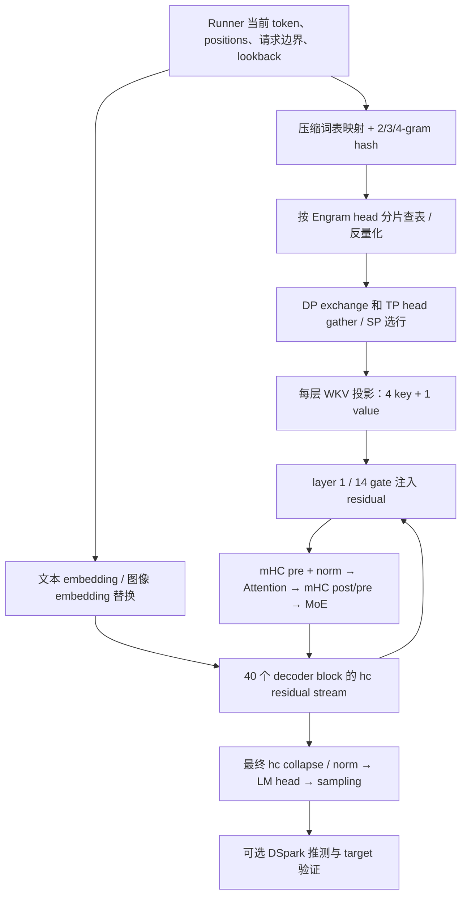

> 历史 main 源码分析，非当前 v0.30.0 实施基线。当前方案见 ENGRAM_CPU_INTEGRATION_PLAN.md。

# DeepSeek V4.1 Flash：Engram CPU 算子接入方案

日期：2026-11-03。状态：源码分析与设计，尚未移植、编译或执行模型测试。

已在两个工作目录从当前 main 创建并切换到 `feat/engram-cpu-v41-integration`：

| 仓库 | 基线提交 |
| --- | --- |
| vllm | `2173d7121fc6e8d756c884f46691546c61b60c57` |
| vllm-ascend | `c116bebbe9c52f3869b895dad6c173bf363eef46` |

保留原有未跟踪文件。本轮新增分析文档，未修改运行时代码，未提交或推送。

## 1. 结论与范围

建议把优化做成可选的 **CPU retrieval backend**：CPU 执行压缩 ID 映射、请求窗口组装、hash、表检索/反量化；GPU/NPU 保留 WKV 投影、gate、mHC、attention、MoE。不要用旧 demo 中的 ShortConv/Engram.forward 替换 V4.1 模型层。

先接通“设备 hash → CPU fused gather/dequant → H2D → 原有通信/投影”的参考通路，再做 CPU hash 和异步流水。前者便于保持请求历史语义，是正确性基线；是否有性能价值需要测量 D2H/H2D。最终完整 CPU retrieval 必须适配设备端 token 来源，不能假设 scheduler 的 CPU token 表总是最新。

`cpu_offload` 当前表示权重存储位置，并不表示 CPU 执行查表。两个仓库当前主路径都是设备 hash + 设备读取主机 UVA 表。新增后端应使用独立配置，保留旧路径供对照和回退。

主要困难不在 SVE 内核移植，而在：ragged batch、设备 token 可见性、跨 rank 顺序、推测提交、异步 buffer 生命周期、图重放 producer 刷新。内核移植难度中等，完整 serving/graph/并行兼容难度高。

## 2. 模型计算流程

配置同时核对本地 `Engram/optimize/v41_cpu_bench/model_config.json` 与 [官方配置](https://huggingface.co/deepseek-ai/DeepSeek-V4.1-Flash/raw/main/config.json)。在线 main 是可变引用；上线验收应冻结 checkpoint revision。原 CPU 测试冻结版本为 `314113f8a7dadb388215396ba5fbee2c610a04d6`，不能自动视作任何未来 checkpoint。

本次配置：40 层、hidden=5120、hc_mult=4，Engram 在 0-based layer 1、14；2/3/4-gram 各 8 个 hash head，每层共 24 head，head_dim=256。全层检索向量为 6144 维；WKV 输出 `(4+1)×5120`，分成 4 个 key 和 1 个共享 value。两层分别有 384006168、384016682 行。



流程说明：

1. 启动时按真实 tokenizer 生成 129280→99092 的 INT32 LUT，并校验 compressed_vocab_size；不是每步执行字符串规范化。每个 Engram 层独立生成乘子、素数和全局桶偏移。
2. 每步为每个请求的当前 chunk 取前三个历史 token；先处理原始请求顺序，再处理 SP/PCP 的本地 token 布局。缺失历史、image/image-pad DEAD 会截断向更老 token 的 n-gram；当前图像位置还必须关闭 gate。
3. 查表只依赖 token 上下文，可提前启动；WKV 同样只依赖检索结果。gate 依赖该层的 hc hidden stream，必须在消费层执行。
4. 层 1/14 的 Engram 在前一 sublayer 的 mHC post 之后、本层 mHC pre 之前注入。不能挪到 attention 后面；PP stage 恰从 Engram 层开始时也要保留这一顺序。
5. Attention 的 Q/KV 投影、norm/RoPE、SWA 与 compressed sparse attention、indexer/candidate 筛选、输出投影继续在设备执行。KV source 层为 2/8/14/20，index source 为 2/8/14/20/24/28/32/36；消费者复用 source 状态，不是每层都独立重算所有缓存。
6. MoE 为共享 expert + routed experts；EP/EPLB 管 experts，Engram head shard 使用独立通信组。配置中的 3 个 next-token prediction 层和 DSpark 是可选推测路径，不代表每次普通 decode 都固定执行。

源码锚点（路径相对各自仓库）：

| 证据 | 位置 |
| --- | --- |
| LUT、布局、hash/history 契约 | vllm `vllm/models/deepseek_v41/common/engram.py:138,211,426,523` |
| 注入顺序和 attention/MoE | vllm `vllm/models/deepseek_v41/nvidia/model.py:486` |
| 全批次 hash、lookup 提交在 SP 切分之前 | 同文件 `:979` |
| Attention source/consumer 与 forward | vllm `vllm/models/deepseek_v41/attention.py:374,754` |
| V2 从设备 token history 取 lookback | vllm `vllm/models/deepseek_v41/nvidia/model_state.py:297` |
| Ascend producer 与图模式入口 | ascend `vllm_ascend/models/deepseek_v41/engram/model_state.py:245` |

## 3. CPU 原型哪些能复用，哪些必须重做

原型来源：`/Users/yangshengxin/Documents/Projects/03.AI/Engram_optimize/Engram/optimize/`。

| 原有资产 | 接入处理 |
| --- | --- |
| `sve_hash_ops.cpp` 的 hash / INT8 gather 算术 | 提取整数 hash、Barrett/SVE2、group32 反量化；增加正式 schema、校验和 out 参数 |
| `v41_cpu_bench/kernels.cpp` 的 MXFP8 gather | 优先支持原生 FP8 E4M3 + UE8M0 group32；保留 BF16 输出，避免中间完整 FP32 张量 |
| `v41_cpu_bench/sve_candidate.cpp` | SVE2 独立编译单元，运行时探测 ISA；不可全工程强制 `-march=armv9-a+sve2` |
| `dispatch.Retrieval` | 不直接复用：它只接受等长 `[B,L]`、固定 8 线程、TP8/layer1/rank0 三头，不接受空 batch |
| `runtime.py`、lookup.npy/spec.json | 不导入 JIT 路径，不把本地 LUT、绝对路径和固定模型素数打包进 wheel；由运行模型生成和校验 |
| 原型 image DEAD 处理 | 当前只标记一种 image token；补齐实际模型 image 与 image-pad 两类 sentinel，并覆盖历史窗口 |
| accepted_plans.jsonl | 仅是特定 CPU/NUMA/线程/分片下的校准记录；上线重新校准，未知场景走可用基线 |
| async_exploration GIL 实验 | 可参考 native/GIL-release 绑定方法；它未验证设备重叠或服务收益 |

当前 Ascend 新路径为 `vllm_ascend/models/deepseek_v41/engram/`，旧报告中的 `vllm_ascend/engram/cpu.py` 已不适用。当前 `_torch_lookup` 是 CPU 测试/bring-up 参考，不是完整 serving CPU backend。

现有 CPU 证据是完整规模的合成量化表、TP8 layer1 rank0、单进程本地检索；不包含真实权重质量、TP/DP、H2D、graph、模型 TTFT/TPOT。不能继承它作为本次集成验收。

## 4. 并行兼容矩阵

以下“现状”来自本次 checkout 的源码约束或测试定义，不代表本轮实际运行通过。

| 模式 | 当前 vLLM | 当前 Ascend | CPU backend 必须保持的契约 |
| --- | --- | --- | --- |
| TP | 按完整 head 分片；ceil 分片，允许尾部 padding，但拒绝有 rank 完全无 head 的布局 | 平台限定 1/2/4/8；24 必须整除有效 TP×EDP | 使用现有 head_start、vocab_start/end、有效 heads；不能写死 3 头或 rank0。TP8 是每 rank 3 头、TP4 是 6 头 |
| TP + SP | 特定 EP/MoE 组合启用；先 full-token hash，再本地 token shard | 有设备侧 token shard/重排逻辑 | head gather 与 token shard 是两个维度；保持最终 token 索引、mask 对齐 |
| DP 独立表 | 支持 | 依配置/runner 而定 | 每 replica 查自己的 tokens，避免误用 DP0 数据 |
| DP 共享主机表 | 支持 node-local shared storage | V2 DP/PCP 自动推导启用 | 表只读共享；每 worker 的任务、staging、event 独立；不新增逐步 DP 检索 collective |
| TP×DP head 分片 | 支持，受有效 Engram DP group/配置控制 | 非共享路径要求均匀头分片；拒绝显式 embedding_across_dp | head_rank=tp_rank×effective_edp_size+edp_rank；先 hash gather，查本地头，再 exchange/TP gather；维持 rank-major 顺序 |
| EP/EPLB | 与 Engram 组分离 | 可组合，elastic EP 被 Engram 配置拒绝 | 不按 expert rank 分配表，也不把 EP world size 当 Engram shard 数 |
| PP | 按本 stage 拥有 Engram 层初始化 hash/表；有 stage-entry 测试 | Engram 配置要求 PP=1 | vLLM 每 stage 获得自己的 token/history 并计算本地层；没有 Engram 的 stage 不分配表；不为 CPU 功能顺带宣称 Ascend PP 支持 |
| PCP | 有 PP/DP 组合测试；PCP 要求 DCP=1，推测仅 fixed DSpark 且 PP=1 等约束 | 仅 V2；先 global 连续请求 hash，再 local_token_indices 选行 | 不能把 front/back 本地 chunk 误当独立新序列；携带真实 positions 与原始请求边界 |
| DCP | PCP 组合明确要求 DCP=1；其他组合需按 attention backend 再验 | Engram 明确 DCP=1 | 不扩大既有支持范围；合法组合逐项验证，不推断全笛卡尔积可用 |
| DBO/ubatch | V4.1 Engram 配置明确拒绝 | 沿用约束 | 保留现有拒绝，不把新 buffer pool 等同于 DBO 支持 |
| 推测 / DSpark | target 校验、draft、replay 有独立实现 | 有 DSpark 与 graph/replay 实现 | 只使用 target 已确认历史；验证 chunk 内允许用前面的候选 token；被拒绝后缀不得提交到持久历史 |

证据：vllm `common/engram.py:735,761,1092,1146,1473,1805`；`nvidia/model.py:262,700,905`；`config/vllm.py:1492`；`tests/distributed/test_engram_dp_shard.py`；`tests/models/test_deepseek_v41_pipeline.py`、`test_deepseek_v41_pcp.py`。Ascend `platform.py:1865`、`ascend_config.py:689`、`engram/embedding.py:60`、`engram/model_state.py:245`。这些测试存在不等于已在目标平台通过。

## 5. 推荐接口和数据流

以下为拟新增接口，不是当前 API：

```text
EngramRetrievalBackend.submit(batch_view, local_layer_tables, workspace) -> ticket
ticket.wait_layer(layer_id) -> device_rows + token_mask
ticket.retire(consumer_done)

cpu_compress_sources_out(raw_ids[T], query_start_loc[R+1], lookback[R,3],
                         dead_masks, token_map, sources_out[T,4])
cpu_hash_out(sources, layer_multipliers, primes, global_offsets, hashes_out)
cpu_gather_dequant_out(codes, scales, hashes, shard_descriptor, bf16_out)
```

`batch_view` 包含 request identity/generation、token positions、有效 T/R、query offsets、PCP local index、每次执行的 epoch；适配混合 prefill/decode，不依赖统一 L。source 保存 INT32（-1/DEAD），hash 乘法/XOR 显式使用 uint64 wraparound，避免 signed overflow；hash ID 保持全局 head 桶偏移。

第一版尽量无新增持久 history：从现有 runner 的权威 token history 提取窗口。若以后维护 CPU history cache，必须以 request ID+generation+绝对 position 为键，accepted-prefix-only commit，并处理 cancel、preempt/resume、fork、slot reuse；不能用 batch 行号作持久键。

两条路线都保留到目标测量完成：

* A：设备既有 hash → D2H hash → CPU fused gather/dequant → pinned BF16 → H2D → 原有 DP/TP/SP → WKV/gate。生命周期风险较小，但每 token 两层 hash 为 48×4=192 B，D2H 延迟可能让短 decode 退化。
* B：设备 pack 当前 token + 最近 3 个 token/请求 → 异步 D2H → CPU compression/source/hash/gather → H2D。prefill 只有在确认 CPU 数据有效且索引完全一致时才绕过 D2H。V1 CPU token 表可能含 placeholder；V2 token/history 在设备。B 并不自动消除设备同步成本。

分片和 collectives 初期继续用现有设备通信，CPU 只处理本 shard 检索。不新增 CPU distributed group 或跨节点 CPU RDMA。共享表复用实际 host Tensor/mapping，不再复制完整权重。D2H host Tensor 的 pending 状态必须通过事件确认后才能交给 CPU worker 读取。

## 6. 异步、图和内存

使用模型所有的有限 workspace pool、固定设备输出地址、pinned host staging 和逐层 ticket。CPU 任务释放 GIL，使用有上限的 native pool；线程总预算按整个节点的 TP×DP worker 数规划，不能每 rank 默认抢 8 核，也不在热路径修改全局 torch 线程数。

状态机：`free → input_ready → cpu_running → copy_enqueued → device_ready → consumer_done → free`。`device_ready` 至少覆盖 CPU gather、H2D 和必要设备格式转换；最终 consumer wait 还必须覆盖其依赖的 DP/TP exchange。buffer 在最后一个设备消费者完成前不可复用，取消请求也不能提前释放。

先让 eager/分段执行工作：模型层先正常计算，真正消费该层时 host 确认 CPU Future 完成、将 H2D 入队并记录 event，再由设备 consumer wait。layer1 优先，layer14 在后；需实测是否独立队列更好。

FULL graph 不能直接 capture Python CPU 任务，更不能假定捕获一次会每步重新检索。初期 graph 兼容基线是在每次 replay 前完成 producer、刷新固定输入，并确保相关 copy/event 已入队；它可能丢失部分 overlap。之后才评估外部事件/分段 graph。不能先启动一个等待尚未 record 的复用 event 的 graph，然后指望 CPU worker 自动唤醒；需定义每个 replay 的 epoch 和 record/wait 顺序。

Ascend 已有 graph 外 producer/event consumer；符合 MRV2 slotless、无 SP、TP=1、PP=1、有效 table dp_size=1 等条件时还会选择图内 producer（`model.py:1295`），此路线禁止 replay 前 Python producer/ExternalEvent record。CPU backend 必须退出图内 producer 选择，提供每次 replay 都刷新的 host producer 路由，不能只替换 `lookup()`。PIECEWISE 还存在本地源码 TODO，不能以通用 graph 声明掩盖。retire/failure 路径同步清理 ticket/event。

原生表为每行 256 B codes + 8 B scale；两层约 202.758 GB（188.83 GiB），不含 padding/运行时。BF16 staging 每层每 token 完整输出 12288 B；两层共 24576 B。TP8 本地两层合计 3072 B/token，需按各分片真实桶数分配主机表，不能简单假设每 rank 字节完全相等。

若 CPU 只 gather 原始 codes/scales，H2D 理论 payload 可由 512 B/head 降到 264 B/head（约少 48.4%），但需要设备反量化，属于后续对照方案；不算 CPU 反量化路径的已证实收益。vLLM 已有 `EngramBatch` packed MXFP8 exchange 和 specialized WKV prefetch，接入必须保留这些路径或明确选择旧后端，不能无声降级后宣称整体优化。

## 7. 两仓改动范围

| 仓库/位置 | 拟改动 | 风险 |
| --- | --- | --- |
| vllm `vllm/config/engram.py` | 独立 retrieval_backend 与 CPU worker budget；纳入配置 hash/校验，默认保留现状 | 配置/平台组合兼容 |
| vllm 新增 Engram CPU backend 模块 | backend protocol、ticket、ragged 元数据、reference 路径 | 生命周期与错误传播 |
| vllm `common/engram.py` | backend factory 与 staged rows 入口；沿用 layout、weight loader、通信和 WKV | EngramBatch/SP 路径 |
| vllm `nvidia/model_state.py`，必要时 AMD 对应路径 | 在既有模型状态扩展点准备真实 token/window、per-step producer；V1 保留基线或专门适配 | async token 可见性 |
| vllm `nvidia/model.py` | 模型拥有 backend/workspace；保留层位置和 mHC 顺序 | decoder replay 与特殊 decode |
| vllm `CMakeLists.txt` / `setup.py` / 新 CXX source | 在 GPU/NPU 使用的 wheel 中也构建独立纯 host 扩展 | 不能只放进 CPU-target 专用扩展 |
| ascend `engram/embedding.py` | 复用共享 host storage，增加 CPU gather backend 适配；保留 UVA | dtype 与共享生命周期 |
| ascend `engram/model_state.py`、`models/deepseek_v41/model.py` | per-replay CPU producer、ready/retire，PCP 顺序保持 | FULL 图/ExternalEvent 风险高 |
| ascend `platform.py` / patch/config | 校验新 backend 与现有受支持 topology；优先使用模型级扩展点 | 不用宽泛 monkey patch 绕开限制 |
| 两仓现有 Engram tests、distributed tests、docs | 扩展现有测试与文档；kernel perf 放 benchmarks | 完整 serving gate |

推荐 host 算术与 schema 在 vLLM 维护一份，Ascend 负责传输/事件/模型适配。独立 CXX 扩展须在 CUDA/ROCm/插件 wheel 构建路径可用；当前仅编辑 `cmake/cpu_extension.cmake` 不会让 GPU wheel 自动含该算子。若先做 Ascend 专用验证包，固定 schema/版本且不与上游重复注册；长期不维护两份 hash 算法。

## 8. 风险、补偿与回退

| 可能破坏 | 补偿和停止条件 |
| --- | --- |
| 请求重排、推测拒绝导致读到其他请求或未来 token | authoritative window、request generation、position；hash 必须逐元素等于旧路径，任一反例停止 |
| D2H 强同步、GIL/OpenMP 抢核使 TPOT 退化 | native pool + 异步 copy，记录 scheduler CPU gap、队列等待；以 serving latency 决定 backend，不凭 kernel speedup |
| rank 不同分支、dummy rank 不参加 collective | 所有相关 rank 一致选择 backend/格式/slot；idle、empty、padding 显式参与原协议 |
| CPU task 异常后其他 rank collective hang | 在进入下一 collective 前做组内一致错误传播；停止整步/engine，禁止各 rank 临时独立切后端 |
| graph 重放旧行、event 复用、异步覆盖 | 持久地址、per-step epoch、consumer retirement；同 shape 不同 token 连续 replay 验证 |
| FP8/UE8M0 与 INT8 混淆、二次量化改变质量 | 使用真实 checkpoint header 选格式；MXFP8 优先，覆盖 scale=0/255、NaN/subnormal、BF16 rounding；不得以合成表数值等价取代质量评测 |
| host 表重复复制或跨 NUMA 访问恶化 | 共用现有 readonly mapping；记录 NUMA/PSS/共享页与 worker 总线程；启动时检查 host 内存预算 |

回退配置保留原设备 UVA 检索路径，拟命名为 `device_uva`（当前没有这个配置值）。启动能力检查失败可以在全组一致的条件下选旧后端；运行时失败先安全终止/退休整个 step，不做不一致的 rank-local 静默回退。没有真实数据证明优于旧路径前，不修改默认 backend。

## 9. 实施与验收顺序

1. **P0 契约和算子产品化**：ragged/out 接口、reference、MXFP8/INT8、CPU ISA fallback、GPU wheel host extension 可加载；覆盖两层、全部 rank shard、空输入/非法输入。先正确性，后性能。
2. **P1 单设备 eager**：设备 hash + CPU lookup 对照，接入真实 checkpoint，保存 hash/rows/logits/token 序列；验证模型层顺序，不改变 attention/MoE。随后完整 CPU hash 通路，明确 token 来源。
3. **P2 并行**：Ascend TP1/2/4/8 全 rank；DP 独立/共享表与空闲副本，TP×DP+EP/SP；vLLM 再测允许的 EDP head shard、PP stage 边界和 PCP。非法组合保持明确拒绝。
4. **P3 生命周期**：混合长度、chunked prefill、prefix-hit bounded replay、preemption、取消/slot reuse、图像 sentinel、DSpark 部分/零接受、连续调度。与旧 backend 对比 hash/rows；数值误差预先定义，真实模型做数据集评测。
5. **P4 异步与 graph**：先 eager 正确 overlap，再 FULL/PIECEWISE 每 replay 刷新，覆盖不同 token 同 shape、padding/dummy、异常退休、有限 pool 压力；每项单独标验收。
6. **P5 服务收益**：同 checkpoint、并行、CPU/NUMA/线程、图模式与请求集做 A/B；收集 TTFT、TPOT/ITL p50/p95/p99、成功吞吐、CPU 时间/利用率、host PSS、设备利用率、D2H/H2D、通信与逐层 wait；由用户 SLA 决定启用范围。

逐层隐藏条件使用实际时间线：`额外 stall_l=max(0, retrieval+copy+必要通信的完成时刻 - 该层需要数据的时刻)`。layer14 窗口通常比 layer1 长，但 PP、设备调度与前层耗时会改变窗口。不能把 CPU p50 相加当作设备实测或保证完全隐藏。

建议首先扩展 vllm `tests/kernels/test_engram.py`、`tests/distributed/test_engram_dp_shard.py`、`tests/models/test_deepseek_v41_{pipeline,pcp}.py`；Ascend 扩展 `tests/ut/models/test_engram*.py`、`tests/ut/worker/v2/test_engram_state_hooks.py` 及已有 V4.1 状态/分布式测试。真实设备 serving/eval 是独立验收，mock UT 通过不能替代。

工作量为工程估算：P0+P1 约 1–2 人周；Ascend 既有 TP/DP/EP/PCP 覆盖约再 1–2 人周；graph、推测、vLLM PP/EDP 和服务评测约再 2–4 人周。以具备匹配设备、真实权重、host 内存和基线为前提；不是性能承诺，Ascend 新增 PP/DCP/跨节点支持另立任务。

## 10. 本轮证据边界

已完成：两仓建分支；当前源代码、配置限制、原 CPU 原型与官方模型配置的核对；形成方案。尚未完成：算子移植、wheel 构建、单测执行、真实 checkpoint、目标 CPU/GPU/NPU、分布式 serving、质量及性能验证。当前机器的源码审计不能证明任何 topology 已实测可用。
