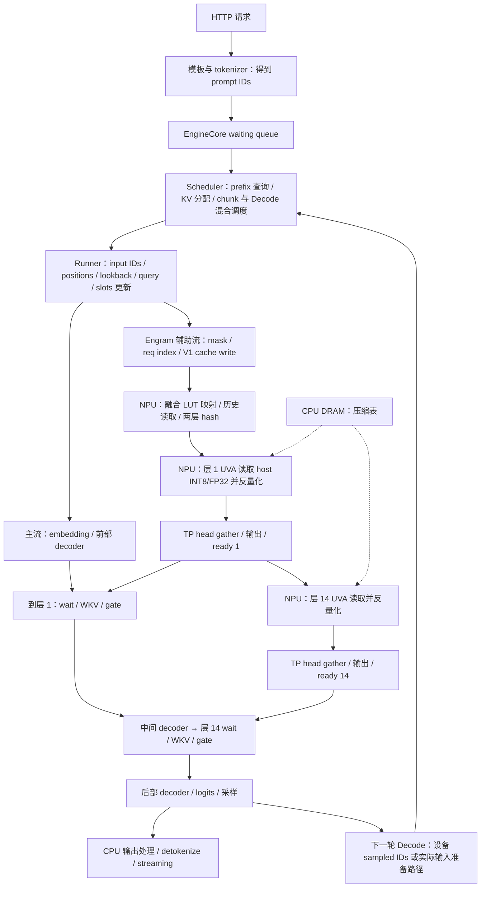
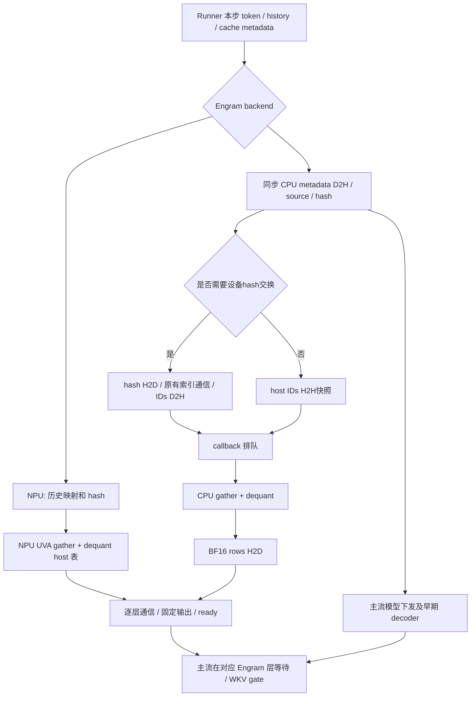

# A3 DeepSeek-V4.1-Flash：NPU/UVA 基线与 Engram CPU 卸载实验计划

版本：2026-11-04，实验前计划，尚无 A3 性能结果。

本文件是实验主计划，数据冻结、负载窗口和代码就绪门槛均在下文定义，不依赖另一份负载协议。本文覆盖实验设计；真实数据、逐 run 清单、专用打点与回放工具仍需交付，不能据此认定实验已经可完整执行或 A3 已验收。

## 源码仓库与配套版本

两仓均以 v0.30.0 为配套基线，必须成对部署；实验使用下列个人 fork 的实验分支，不是上游默认分支。

| 仓库 | 远程地址 | 实验分支 | 本次代码版本 |
| --- | --- | --- | --- |
| vLLM | [Wuming-HUST/vllm](https://github.com/Wuming-HUST/vllm) | `feat/engram-cpu-v41-integration` | `5b4777525342b1e74b3ecaad36481f701d928dc4` |
| vLLM-Ascend | [Wuming-HUST/vllm-ascend](https://github.com/Wuming-HUST/vllm-ascend) | `feat/engram-cpu-v41-integration` | `bbafe101803384346e9d7d371657e62ecbf59041` |

上游来源分别为 [vllm-project/vllm](https://github.com/vllm-project/vllm) 和 [vllm-project/vllm-ascend](https://github.com/vllm-project/vllm-ascend)。原始集成提交分别为 `4a5d453d8bc86e09fd51ab8dff4156bb772592c6` 和 `59a979ef168500ba12682cdb6f669f96be450e7b`；仅检出这两个旧提交不包含本次 host-hash 直通与 V1 异常清理修复。

```bash
git clone --branch feat/engram-cpu-v41-integration https://github.com/Wuming-HUST/vllm.git
git clone --branch feat/engram-cpu-v41-integration https://github.com/Wuming-HUST/vllm-ascend.git
```

分支会继续变化。冻结时记录实际 `git rev-parse HEAD`、dirty patch/必需未跟踪文件及 SHA256、native 库 SHA256；表中为本次代码提交，包含本计划的后续文档提交另记实际 HEAD。后续打点或回放实现必须另记版本，不复用旧源码哈希冒充新实现。

模型固定为 [Eco-Tech/DeepSeek-V4.1-Flash-1017-w8a8](https://www.modelscope.cn/models/Eco-Tech/DeepSeek-V4.1-Flash-1017-w8a8)，revision：
`12b85455a58c7df345c1abc43934624a76bac576`。
第 1/14 层表为 INT8 codes + E8M0 scales，group32；当前 loader 在加载时将 scales 转成 FP32，运行时表为 INT8/FP32，每步命中行反量化为 BF16。不是整表 BF16，不重复量化 codes。
权重 header、版本和校验记录见 [权重量化核对](engram_cpu_a3_model_quantization_zh.md)。
部署和固定来源 recipe 见 [A3 Docker 部署指南](engram_cpu_a3_docker_zh.md)。

## 默认 NPU/UVA 模式：从请求进入到 Prefill、Decode

本节的“默认”指本实验 A 模式：A3 recipe 的 `cpu_offload=true, lookup_backend=device`，不是未配置 offload 时所有 vLLM 平台的全局默认值。CPU DRAM 存放压缩 Embedding，NPU 执行 Engram 词表映射、hash、UVA 读取和反量化；模型主干、WKV、gate、残差融合都在 NPU。流程以当前配套分支的 **V1 runner、DP4/TP4 + EP、dp_shared_memory=true** 为主。

### 启动时只做一次的准备

- tokenizer/Engram 初始化生成 token-ID → compressed-ID 的 INT32 `token_map`，加载 hash multipliers、primes、offsets。文本 tokenizer 与这张压缩 LUT 是两件事，不能把 tokenizer 耗时记成 Engram 词表转换。
- 按 TP shard 加载第 1/14 层 Embedding codes/scales；E8M0 scales 数值转换为运行时 FP32，codes 保持 INT8。该加载转换不计入稳态每步反量化时间，冷启动另报。
- `aclrtHostRegisterV2` 注册 host 表，并用 `aclrtHostGetDevicePointer` 建立 NPU 可访问地址。UVA 每步仍需实际跨 host-device 链路读 DRAM，不等于表已搬进 HBM或读取免费。
- 分配历史/slot cache、rows/mask buffer、producer stream 及 event；初始化图 bucket。capture/warmup 与稳态 replay 分开。

### 一个请求如何进入执行队列

1. HTTP 服务接收请求，完成模板/解析、文本 tokenizer，得到模型 token IDs 和采样配置；纯文本是主实验，图像哨兵另作正确性用例。
2. `AsyncLLM.add_request()` 经 input processor 产生 `EngineCoreRequest`，`_add_request()` 送 EngineCore；scheduler 把请求放入等待队列。此时当前实现还没有计算该请求整段 prompt 的 Engram。
3. scheduler 按 token budget、KV 空间和运行中 Decode 需求选择请求，查询 prefix cache、分配 KV blocks、处理抢占。prefix 查询是调度过程的一部分，不能假设 tokenizer 完成就已经知道最终命中范围。
4. scheduler 下发本步 request order、每请求 scheduled tokens、computed tokens、block/slot 等；runner 准备实际输入。一个模型 step 可同时包含 Prefill 与 Decode，必须按真实组成分类。

普通本地 prefix cache 命中通常复用仍在设备 KV 池中的 blocks，**不会必然发生 DRAM → HBM 提升**。只有显式启用 KV offload/connector/外部缓存才有相应搬运；这些配置单列实验，不用假定的 KV 搬运时间作为 CPU 可隐藏窗口。

### Prefill：本轮实际计算的 chunk 如何经过 Engram

| 顺序 | 执行位置与源码锚点 | 数据和依赖 | 本实验应观察什么 |
| --- | --- | --- | --- |
| P1 输入准备 | runner `_prepare_inputs()` / `_prepare_input_ids()` | 将本轮需要计算的 prompt tokens 打包到 `input_ids`；准备 positions、query offsets、slot mapping、block table 并送 NPU | host prepare、各项 H2D、真实/补齐 token 数，而不是整个 prompt 长度 |
| P2 chunk 前历史 | upstream `_prepare_lookback_token_ids()` | CPU 从 prompt 取 chunk 起点前最多 3 个 token，缺失为 -1；lookback H2D。不是把整段历史复制到 NPU | prefix 后首 chunk、续 chunk 的 history 值与传输 |
| P3 producer 启动 | `_model_forward()` → `prepare_engram_inputs()` | 在 `run_model()` 前刷新 Engram；启用 overlap 且模式允许时，辅助流等待输入更新后工作，主流下发前部 decoder | enqueue 与实际输入 ready 分开；这是当前 runner 内计算起点 |
| P4 mask/请求索引 | `prepare_engram()`、`_engram_req_index_kernel` | 生成有效 mask、确定每个打包 token 所属请求，排除 padding/图像 dead tokens | mask、request-index kernel；mask ready 单独关联 |
| P5 历史缓存/词表映射/hash | `AscendNgramHashState.forward()` | V1 `_write_hash_cache_kernel` 写入当前 token 的压缩 ID；`_hash_ids_kernel` 按当前 chunk → prompt lookback → slot cache 的优先级取历史，做 LUT 映射及滚动 hash | 请求索引/缓存写入/hash 实际设备时间；LUT 与历史构造融合在 hash，不能声称已有独立 LUT kernel |
| P6 多层 hash 输出 | 同一个 hash launch，layer 维度并行 | 得到 `[N, 2, 24]` INT32：两层分别有 2/3/4-gram × 8 heads。两层 hash 共同计算，不能各计一遍总 kernel 时间 | 共同 hash 时间及 N；第 1/14 层查表分别记录 |
| P7 分布式路由 | `gather_engram_hashes()` | 当前 shared-memory 配置跳过每步 Engram DP hash gather；其他布局如触发 collective，按实际计入 | 无 collective 则明确写 not_executed，不填写猜测值 |
| P8 每层 UVA lookup/dequant | `embed_gathered()` → `lookup()` → `_engram_host_uva_gather_dequant_kernel` | 按 hash ID 选本 rank head/vocab 范围；NPU 从 host DRAM 读 INT8 codes/FP32 scales，转换、乘 scale 后写 NPU BF16 rows | **融合 UVA gather+dequant** 实际 kernel 时间，包含跨链路读取；没有完整 rows 的显式 H2D copy |
| P9 rows 通信/ready | `embed_gathered()` / `prepare_engram()` | 当前 TP4 保留 head all-gather；必要布局才有 DP rows exchange，随后 padding/固定输出并发布本层 ready | collective、padding/output 与 ready；UVA 时间不包含后续 TP all-gather |
| P10 消费 | model `forward()` 的层循环 | 主流到对应 Engram 层等待 mask/rows ready，执行 WKV/gate/residual，再继续主干 | layer_idx=1/14 的 reach/ready/resume，实际等待和 step 完成 |
| P11 后续 chunk/首 token | scheduler/runner/采样/输出 | 未完成 prompt 则继续调度 chunk；最终 prompt chunk 产生首个生成 token，进入 Decode | 首 token 的 TTFT 包含 tokenizer、排队、全部 Prefill chunks 与输出链路 |

例如 131072-token prompt、8192 token budget，不是每次 hash 131072 个 token；按 scheduler 的实际 chunks 计量，mixed batch 时每个 chunk 还可能更小。prefix 命中的 token 通常跳过主干和 Engram 重算，但待算后缀开头仍需正确 ngram 历史；全命中也可能因 logits/块边界规则算少量 token，以实际 scheduled tokens 为准。

### Decode：上一轮输出如何进入下一轮 Engram

1. 最后一个 Prefill step 采样得到第一个生成 token `y1`；下一 Decode step 将 `y1` 作为输入，生成 `y2`，依次推进。不是先算 `y2` 的 Engram 再采样 `y2`。
2. 无 speculative 时，每活跃请求本轮一般输入 1 token，局部 batch 为 B 则 `N_real≈B`；已有上下文 K 主要影响 attention、KV 容量和可掩盖窗口。B、K、图 padding 都需分别记录。
3. runner 维护前一轮 device sampled IDs。在异步调度路径中可通过 `_prepare_input_ids()` 按 request mapping 在设备侧复用；CPU 接收结果/输出 bookkeeping 的 D2H 可能另有发生，不能概括成 Engram 必须先把 `output_id` D2H 做压缩、再 H2D。
4. prompt lookback 只提供 prompt 范围的原始 token；生成位置在 host token table 可能仍是 placeholder，lookback 对这些位置填 -1。NPU 从 V1 slot cache 读取已处理生成 token 的压缩历史；当前 token 先写 cache，再做 ngram/hash。不得把异步 placeholder 当成真实 token。
5. 后续仍走 P4–P10：NPU 词表/历史/hash → NPU UVA gather+dequant → TP head gather/必要通信 → ready → 对应层 wait → WKV/gate。host DRAM 只存表，不执行 CPU 查表/反量化。
6. `FULL_DECODE_ONLY` 下，满足条件的纯 Decode 使用 FULL replay；当前 V1 的 Engram producer 每步在图外刷新，消费者的 ExternalEvent wait/reset 在图内。混合批/Prefill 的实际模式另记，不能用一次 capture 的 Python 事件当成每次 replay 耗时。



图表示依赖而非已测时间线。producer 按层顺序提交，并非两套独立查表线程池；TP collective、mask 等待、图策略可能限制重叠。配置 layer_idx=[1,14] 为零基编号，即从 1 数的第 2/15 个 block，不混用编号。

源码锚点：vLLM `v1/engine/async_llm.py:add_request/_add_request`、`v1/core/sched/scheduler.py:schedule`、`v1/worker/gpu_model_runner.py:_prepare_input_ids/_prepare_lookback_token_ids`；Ascend `worker/model_runner_v1.py:_prepare_inputs/_model_forward/_get_engram_device_inputs`、`models/deepseek_v41/model.py:prepare_engram_inputs/prepare_engram/forward`、`engram/hash_state.py:AscendNgramHashState.forward`、`ops/triton/engram_hash.py`、`ops/triton/engram_lookup.py`、`engram/embedding.py:embed_gathered/lookup/wait_lookup`。实验保存实际 commit+patch，不能只按漂移后的行号找 kernel。

目标是在同一台 A3、同一真实 checkpoint 和资源预算下回答：

1. CPU 词表转换、hash、Embedding 检索及反量化，完整交付 NPU 可消费的 rows，是否比 NPU hash + UVA 检索更快？
2. 算子差异经过 layer 1/14 异步掩盖、数据传输和 TP 等通信后，对模型 step、TTFT、TPOT、E2E 的净影响是什么？
3. 在哪些 Prefill/Decode、batch、上下文、线程数、NUMA、并行配置下持平、获益或退化？达到持平最少需要多少 CPU 核？

“持平”必须基于预先确定的误差带和置信区间；不以单次最好结果、CPU 单算子加速或 NPU 算子时间减少代替 E2E 结论。

## 1. 执行顺序、两种主实验模式与固定条件

**第一步只跑 A：**在固定模型/拓扑下采集 NPU/UVA 随 Prefill chunk、Decode batch/上下文变化的实际耗时、通信、layer 1/14 等待和 E2E；再与既有 CPU 穿刺的匹配格式/shape 作可行性筛查。**第二步跑 B：**替换为 CPU 词表/source、hash、lookup/反量化，测每阶段及完整 E2E，并与 A 成对复验。**第三步按证据决定：**若 B 因准备晚到形成关键路径等待，再研究 Prefill 提前 hash/查表；该第三步不是当前已实现功能。章节 M1–M4 是测量层次，实际执行遵守本顺序，不要求先完成 CPU 调优才采 NPU 基线。

| 阶段 | 主要工作 | 必交产物 | 转阶段条件 |
| --- | --- | --- | --- |
| A：NPU 基线 | G0、A 路径正确性、P0/P2 采集；Prefill 长序列/Decode 多 batch 短 query | 绝对时延表、两层时间线、通信与等待、CPU 穿刺对照和证据缺口 | A 可重复、时钟/shape/graph 清楚；不以 CPU 必定更快为门槛 |
| B：CPU 替换 | CPU 正确性、反量化专项、线程/NUMA初筛、完整分支与 E2E | 同 shape A/B 对照、gather+dequant 与独立 dequant、TTFT/TPOT/E2E/CPU 成本 | 数值和异步正确、控制变量一致；正式比较重新成对跑 A/B |
| C：提前计算 | 若需要，设计 Prefill 更早的 hash 或 lookup producer | 提前量、队列成本、无效工作、消费者等待和 E2E | 先确认关键路径是 late-ready，且提前不改变历史/prefix/取消语义 |

| 模式 | 配置 | 执行路径 | 用途 |
| --- | --- | --- | --- |
| A：NPU-UVA | `cpu_offload=true, lookup_backend=device` | NPU 压缩词表/历史/hash；NPU 经 UVA 读取 host 表，在 NPU gather/dequant；原有通信及消费 | 主基线 |
| B：CPU | `cpu_offload=true, lookup_backend=cpu` | 同步 CPU 历史/词表转换/hash；无每步hash collective时直接CPU lookup，有collective时保留设备索引交换；CPU 回调 gather/dequant；BF16 rows H2D；原有通信及消费 | 主候选 |
| A0/B0：无 overlap | 与 A/B 相同，`multistream_engram_overlap=false` | 在同一图策略下关闭模型 Engram 辅助流掩盖 | 解释异步收益，非主服务结论 |
| A1/B1：有 overlap | `multistream_engram_overlap=true` | eager/NONE 或 FULL 的辅助 producer、逐层 ready 与消费者等待 | 主性能比较 |

主比较始终是 A1 对 B1；A0/B0 是消融。若实际服务使用 PIECEWISE，必须单列比较：当前代码对 PIECEWISE 同步准备，不能声称它具有相同的 layer overlap。

两种模式都将表放在 CPU 内存。A 的“CPU 存表”不表示 CPU 执行查表；UVA 是 NPU 使用已注册 host 地址访问表。B在本次Ascend快速路径中，CPU hash直接交给CPU lookup：当dp_shared_memory=true或Engram DP size≤1时，消除hash H2D和lookup IDs D2H。需要每步设备hash collective的布局保留往返。runner metadata D2H仍存在，所有实际传输和同步都必须计入。

主比较固定：checkpoint/量化文件、实际加载表的 codes/scales、tokenizer、prompt token IDs、生成规则、最大上下文、KV 容量、图 bucket、runner V1/V2、调度配置、TP/DP/EP/PCP/SP、CPU/内存亲和、容器限制、NPU 时钟策略、采样及网络位置。保留完整有效配置，不能只保留启动命令。

不在主比较中换表格式、预先把整个 INT8 表转成 BF16、删除 event、跳过通信、强制缓存命中、启用不同 speculative 配置或提高 CPU 总预算。

## 2. 已核对的源码事实及待补工具

### 2.1 当前代码实际做什么

- `CPUHashWorkspace.run()` 将 query offsets、IDs、positions、lookback、dead mask 等复制到 host，V1 还可能复制 slots/block table，然后构造 INT32 sources 和 hash。多次同步复制及旧输出租约等待都在模型下发前，不能当作已被 decoder 隐藏。
- `cpu_kernel=auto` 对 gather 选择可用 NEON，否则 portable；`sve2` 必须显式选择。**服务 hash 当前默认 portable unsigned arithmetic，选择 SVE2 gather 不会自动选择 SVE2 hash。**独立 hash microbench 的 SVE2 收益不能直接归入服务。
- `CPUEmbeddingLookup.lookup()` 对设备IDs提交D2H；对host IDs制作H2H快照，然后提交C++ host callback、BF16 H2D。上一轮 staging 的 `retire()`、本轮 callback 检查 `check()`/`finish_cpu_engram()` 都可能产生 host 等待，须单独测量。
- Ascend 当前使用一个 Engram producer stream，按实际 Engram layer 列表逐层 lookup 和通信，逐层发布 ready。layer 14 可与主流较早 decoder 计算重叠，但不是 layer 1/14 两套独立 CPU 池同时执行；layer 14 可能排在 layer 1 的 H2D/collective 后。
- ready 在 rows、padding、输出写入及必要 DP/TP 交换后发布。CPU 回调返回不等于模型 rows 已可消费。
- FULL 使用 `ExternalEvent.wait/reset`。CPU producer 在图外每步刷新；图回放不重新进入消费者 Python layer 函数，不能仅靠 Python layer hook 测回放等待。
- SP 的 mask 等待可能早于首个 Engram layer；PCP 必须按全局连续请求构造 hash，再选择本 rank 的 token；idle rank 也可能参加 collective。
- 当前 Ascend 配置约束：TP=1/2/4/8，PP=DCP=1，不支持 `embedding_across_dp` 和 elastic EP；V1 不支持 PCP。合法配置不等于已在 A3 验证。

### 2.2 已有工具与缺口

| 项目 | 当前已有 | 本实验还需准备 |
| --- | --- | --- |
| CPU 构建/数值 | `tools/validate_engram_cpu.py`、`tests/kernels/test_engram_cpu.py` | A3 host 上实际构建；NPU callback/graph case 必须运行而非 skip |
| CPU microbench | `benchmarks/kernels/benchmark_engram_cpu.py` | 真实表/真实 IDs、大 working set、多 rank 同时执行；现有默认小表不能代表真实 UVA 比较 |
| checkpoint smoke | `tools/validate_engram_cpu_model.py` | 长上下文、prefix/chunk/mixed、并行与取消等扩展回归 |
| 服务压测 | 当前版本 `vllm bench serve`、`/metrics`、torch_npu profiler | 固定数据集、到达轨迹、稳定窗口、运行清单和统计汇总 |
| 细粒度 Engram 时序 | 普通框架 trace 和现有 event | 下文打点表中的 callback 运行/排队、分层 ready/wait、租约等待等专用标记 |
| 相同调度轨迹比较 | 暂无完整专用工具 | step 输入/状态快照、teacher-forced token 回放和每次状态恢复工具 |

本文件及配套 CSV/JSON 是计划和接口约定。后两行工具及专用打点尚未实现，不能把后面的建议事件名当作当前日志已存在的字段。

### 2.3 第一阶段就绪门槛

| 交付项 | 当前状态 | 正式实验门槛 |
| --- | --- | --- |
| 核心 CPU 路径 | source/hash、融合 gather/dequant、host IDs 快照与异常清理已接入 | A3 上同 metadata 的整数 hash 一致、rows/生成误差规则预设并通过 |
| 启动与留档 | 脚本显式 prefix off、chunked prefill on，支持 chunk/请求上限/OMP、dry-run、独立 run 目录 | 读取 worker 实际配置及线程/affinity；请求值和目录存在不算启动成功 |
| callback/graph/parallel | 本机 CPU 检查通过，目标用例未验收 | NPU callback、连续 FULL replay、DP4/TP4、idle rank/slot 复用实际执行，不能以 skip 替代 |
| 真实算子入口 | 现有 microbench 默认小表 | 使用 TP4 真实 shard、真实 INT8/FP32 表与冻结 IDs；小表只供调试 |
| 专用时序与关联 | callback/ready/wait、runner request→step/rank/graph 导出待补 | metadata 同步、source/hash、callback 排队/执行、H2D、通信、ready/reach/resume 可关联；不可测填 unavailable，量化 P0/P1/P2 扰动 |
| 数据与运行清单 | 设计规则已定义，数据和逐 run 展开工具待补 | 冻结 manifest/requests/IDs/arrivals、SLO/超时、样本预算和停止规则 |
| 固定 worker 回放 | 待实现 | 恢复 KV/history/accepted tokens；未完成只能报告自然服务比较 |

A 正确性通过后可先采无 profiler 的 E2E 与短 trace；B 先过数值、callback/FULL 和主拓扑门槛再比较。打点未齐可作 E2E 初筛，不能发布完整阶段归因。独立反量化诊断、混合卸载与 C 提前计算不阻塞首轮 A 基线。

本次发布的本机检查：CPU 数值测试 102 passed / 31 skipped；隔离执行实际 Python 方法的路由/清理回归 18/18 通过（旧 HEAD 5/18）。完整 Ascend UT 因依赖缺失未执行，NPU/CUDA/SVE2 跳过不算验收。完整 pre-commit / `format.sh ci` 在外部 hook 依赖安装阶段受阻，已执行的 Ruff/format、语法和空白检查通过；详见[发布检查记录](../../../artifacts/engram-cpu/20261104-a3-publication/README.md)。

## 3. 阶段 G0：机器、软件和 checkpoint 核验

正式计时之前生成 `manifest.json`，模板见 [manifest.template.json](engram_cpu_a3/manifest.template.json)。所有未知项必须现场填写。

### 3.1 A3 与 CPU 拓扑

收集以下只读信息，保留命令、退出码和原始输出：

```bash
uname -a
lscpu
lscpu -e=CPU,NODE,SOCKET,CORE,ONLINE
numactl --hardware
npu-smi info
npu-smi info -m
cat /proc/meminfo
cat /proc/self/cgroup
df -h /dev/shm
```

- 核对 A3 物理板卡、chip、逻辑 NPU、可见设备及 rank 对应关系，不默认“一台 A3=8 个逻辑设备”。按机上工具帮助收集 NPU 拓扑、CPU affinity、链路；记录不支持的查询，不填估计值。
- 核对 CPU 真正型号、920/950、ISA/OS 能力、socket/NUMA、每 node 可用物理核、SMT、内存容量/频率/通道、NUMA distance、NPU 到各 node 的可达性。A3 不自动代表 host CPU 是 950。
- 记录 governor/频率策略、NPU 频率/功耗/温度、THP/huge page、swap、memlock、容器 cpuset、CPU quota 和 memory limit。主实验不换 BIOS/OS 策略。
- 记录 `Cpus_allowed_list/Mems_allowed_list`，每个实际 worker、callback、OMP/runtime/通信线程的 TID、affinity；预热后再检查一次。Ascend 默认绑核可能覆盖外部 `taskset` 的设计。
- 优先独占实验节点；同一时间只跑一个 A/B 实例，客户端在独立机器或预留 CPU 上。记录所有背景负载和监控频率。

### 3.2 软件与实际加载代码

- 两仓 commit、dirty patch/未跟踪必需文件哈希、tag、native `.so` SHA256、编译器/flags；确认进程 import 的 `vllm`/`vllm_ascend` 来自预期源码。
- OS/kernel、驱动/固件、CANN、torch、torch_npu、Python、Triton-Ascend、HCCL、custom ops、NUMA 库版本；容器 image digest、依赖锁定清单。
- 使用内网已验证能运行该 checkpoint 的兼容软件配套；不能仅因本地源码或最新 API 文档存在，就假设机上 CANN 支持 callback、外部 event 和图。
- 保存 `vllm serve --help`、`vllm bench serve --help`；现场检查示例参数是否存在。完整运行中不联网装依赖、不 JIT 编译 CPU 算子。

### 3.3 checkpoint 与容量核验

1. 记录确切模型名、revision、全部 config/tokenizer/quantization/index 文件哈希，weights 的已验证校验清单；区分 full model、截层模型、Engram 被禁用的模型。**Engram 关闭的 A3 成功记录不能作为本任务可运行证据。**
2. 从实际 config 读取 Engram layer IDs、hash heads、最大 ngram、head_dim、词表大小和每 head 行数。预期常见 Flash 形状是 `[1,14]`、每层24个 hash columns、dim=256，但以 checkpoint 为准，记录 layer ID 是零基还是一基，不自行加减。
3. 单独检查 `layers.{layer_id}.engram.embed.weight` 和 `.scale` 的 safetensors header、shape、dtype、分组大小；记录最终 loader 选择的 index 文件及 shard。整体 W8A8 不能证明 Engram 是 INT8。
4. 本次固定 checkpoint 已提供 INT8 codes，源 E8M0 scales 加载为 FP32；记录两种 scale dtype 和实际加载 codes/scales checksum，不将其称为 MXFP8→INT8 重新量化。两模式使用相同运行时表；其他checkpoint的格式转换只作独立扩展。
5. INT8 group32/FP32 scales 的逻辑读字节为 `D + 4D/32`，D=256 时是288 B/row；BF16 输出是512 B/row。BF16 表则512 B/row。scale 格式不符时按实际重算。
6. 按真实 shard 求 codes、scales、replicas/shared table、CPU slot cache、pinned staging、NPU 输出 buffer、KV 和 graph cache 的容量；DP 共享按物理存储/PSS统计，不能累加每进程 RSS 作为主机占用。
7. 检查 `/dev/shm`、RAM、memlock 和 HBM 留余量；不得通过 swap 或异常 page fault 撑起“成功”样本。容量不足的 TP 拓扑标记 infeasible，不能用缩小表替代完整模型并沿用结论。

G0 首先确认 A 可创建实际表、Engram layer 非空、容量可容纳且软件接口可用，随后即可采集第一步 NPU 基线。进入第二步 B 时，再确认两模式加载相同表及 CPU callback 接口可用；不因 B 工具尚未完成而阻塞 A 的采集。

## 4. 时间边界：从请求进入到最后一个 token

### 4.1 Prefill/Decode 实际位置

请求主链为：客户端到达 → HTTP/front-end → tokenizer/预处理 → engine 排队 → scheduler/prefix block 查询与分配 → runner 输入/历史准备 → Engram 准备 + decoder → logits/采样 → 输出/detokenize/stream。

词表压缩 LUT 是 Engram 的 token-ID 映射，不是文本 tokenizer。当前 CPU 模式在 worker 的 model dispatch 前对本 step 的 scheduled tokens 做转换/hash，不在 HTTP 接收或请求等待队列里提前把整个 prompt 算完。

Prefix cache 命中的历史 KV 一般无需重算对应 tokens 的 Engram/decoder；但缓存后缀的首几个 ngram 仍需正确历史。完全命中也可能因最后 token/logits、块对齐等规则计算少量 token。必须记录 scheduler 实际 computed/cached/scheduled tokens，不能简单用 `prompt_len*(1-hit_ratio)` 推算。

Decode 在当前 step 对生成 token（以及启用 MTP 时的 verification query）处理；此前 KV 长度影响模型 attention 和可隐藏窗口，不能用当前 query token 数代替上下文长度。



图只描述依赖，不能据此推断实际重叠比例。A/B 的 ready 和主流运行必须在 trace 中核对。

### 4.2 客户端指标

对请求 i 定义：`a_i`=计划到达，`s_i`=实际发送，`f_i`=首个有效生成 token 到达，`l_i`=最后生成 token 到达，`d_i`=流结束/DONE，`O_i`=实际输出 token 数。

| 指标 | 定义和边界 |
| --- | --- |
| 客户端排队 | `s_i-a_i`；并发 semaphore 等待属于这里，不归入服务器 queue |
| TTFT | `f_i-s_i`；另报含客户端排队的 `f_i-a_i` |
| TPOT | `O_i>1` 时 `(l_i-f_i)/(O_i-1)`；O=1 时不计算 |
| ITL | 相邻 token 到达间隔；SSE chunk 若含多个 token，记录 chunk/token 对应关系，无法还原时标为 chunk 间隔 |
| E2E-token | `l_i-s_i`；完整 HTTP E2E 为 `d_i-s_i`，两者区别为流收尾 |
| 用户总完成时间 | `d_i-a_i`，包括负载生成端排队 |
| workload makespan | 第一条测量请求发送至最后一条测量请求完成；另报包含 drain 的总时间及固定稳态窗口 |
| 吞吐 | 成功请求/s、output tokens/s、input tokens/s 分列；cached 与实际计算 input tokens 分列 |
| goodput | 固定 TTFT、TPOT、E2E SLO 全部满足的成功请求/s，SLO 在看结果前确定 |

单请求 token 时间有恒等式 `E2E-token=TTFT+(O-1)*TPOT`，但**各项 p50/p99 不能相加**，平均 TPOT 也不是 p99 ITL。benchmark 的 `e2el` 按本版本实际返回字段核验是否含流收尾；不要直接与另一个工具的 E2E 混用。

### 4.3 服务器及 model step 指标

- front-end：HTTP 收到、tokenization start/end、送 engine；engine：enqueue、每次 schedule/reschedule、完成、发首/尾 token。异步/多进程用 request_id 和 step_id 关联。
- server queue：enqueue 到首次 schedule；被抢占的再次等待另记。现有 prefill/decode 指标是时间区间，可能包括 preemption，不能直接叫纯 NPU 计算时间。
- step host：收到 scheduler output、输入准备、Engram prepare start/end、model dispatch start/end、`finish_cpu_engram` start/end、输出可交付。
- step device：本步输入依赖可用到 logits/采样或预先定义的 device done marker；CPU 前缀不在 NPU 时间里，必须同时报告 worker/engine 完成时间。
- all-rank completion：报告每 rank、max/min 和关键 rank。一次 barrier 的返回耗时含 rank skew；不能以 rank0 或平均 rank 时间代表整体。
- E2E 服务结果直接来自真实请求完成时间。不能将每步 max-rank 时间或 Engram 时间相加，当成并发请求的 E2E。

## 5. Engram 分支与异步掩盖的计时

### 5.1 必须报告的分项

| 类别 | A：NPU-UVA | B：CPU |
| --- | --- | --- |
| 输入/历史 | NPU lookback、request index、cache 更新、token map | metadata D2H及其同步等待、旧 hash buffer 租约等待、source/cache 更新、token map |
| hash | NPU hash kernel 实际执行 | CPU hash 墙钟及 CPU time；仅设备交换路径有hash H2D |
| 索引通信 | 原有 gather/padding/PCP selection | 同协议，单独计时 |
| 查表前 | launch/producer wait | staging retire/grow、H2H快照或IDs D2H、callback enqueue/queue |
| 查表 | UVA gather+dequant 的融合 NPU kernel | callback 内 gather+dequant 的实际运行 |
| rows 传输 | UVA 读取已融合于 kernel，无独立完整 rows H2D | BF16 rows H2D，字节按实际 padded 输出 |
| 查表后 | row exchange/TP gather/output/padding/ready | 同协议，单独计时 |
| 消费/收尾 | mask/逐层 wait、WKV/gate、主流 join | 相同，再测 callback 检查和 copy retirement |

融合 kernel 不强行拆成不可观测的“读取”和“反量化”两项；如需拆解只能另做诊断 kernel，标为消融。A 的 UVA 时间不能再加一遍估计 host DMA 时间；B 的 CPU gather 时长也不能再加分项 p50 冒充完整分支。

模板中的 `output_ready_ms` 统一定义为“最后一个必要 lookup/collective 完成 → 本层 ready 实际发布”的区间，包含输出整理/padding；`producer_elapsed_ms` 是输入依赖满足 → ready 的完整墙钟。callback_total 包含 fused_gather_dequant，后者不是可再相加的额外阶段。实际时间戳/区间另保留在原始 spans 中。

### 5.2 layer 1 / layer 14 指标

对每步、每 rank、每实际 Engram layer l，记录同一时间基准上的：

- `producer_input_ready`：producer 输入依赖实际满足；host 的 enqueue timestamp 另记。
- `ready_l`：该层数据和通信真正完成，层 ready 实际 record；保留 event generation。
- `reach_l`：主流到达层 event wait 之前；`resume_l`：等待后首个实际消费者可执行。
- `wait_l=resume_l-reach_l`：event 等待的设备时间。若 runtime 不能直接分辨 wait，报告含 wait 的 marker 区间和测量空载开销，不把 Python `wait_event()` 返回时间当等待。
- `slack_l=reach_l-ready_l`：正数表示准备提前完成；负数表示数据晚到。仅在时钟对齐、依赖单一且测量有效时使用。

主流可能先等待 mask、再等待 rows；分别统计，避免将同一停顿重复计数。SP 的早期 mask wait也要计入。layer14 的到达时间可能已被 layer1 阻塞推迟，**layer14 零等待不证明 layer1/14 总开销完全隐藏**。

额外报告：每层 producer input→ready 完整 elapsed、queue+callback elapsed、hidden_ms、overlap 的区间交集、step/TTFT/TPOT 净变化。区间交集使用区间 union/intersection，不能加所有流时长后除墙钟。

`wait≈max(0, ready-reach)` 只作对单一依赖的诊断校验；host 同步前缀、内存带宽争用、TP 延迟、租约复用和收尾检查都会影响完整 step，不能仅用 wait 推导 E2E。

## 6. 打点实施清单

机器可读清单见 [instrumentation.csv](engram_cpu_a3/instrumentation.csv)。下表是需增加/校准的位置，不是承诺当前代码已输出所有字段。

| 层次 | 文件/函数锚点（相对各仓） | 计划事件 |
| --- | --- | --- |
| 请求 | vLLM openai serving/input processor/tokenizer/输出 processor | request received、tokenize、enqueue、first/last、done |
| 调度 | `vllm/v1/core/sched/scheduler.py: schedule/add_request`，KV cache manager prefix 查询 | queued、prefix lookup、allocate/preempt、step input manifest |
| V1 worker | Ascend `worker/model_runner_v1.py: execute_model/_model_forward` | prepare inputs、Engram prepare、forward submit、CPU finish、output completion |
| V2 worker | Ascend V2 runner + `engram/model_state.py: prepare_engram_inputs/prepare_engram/finish_execution` | prepare/replay 每步关联和 retirement |
| CPU source/hash | vLLM `model_executor/layers/engram_cpu.py: CPUHashWorkspace._host/run/publish + sources_out/hash_out` | 每类 D2H、hash lease wait、source、hash、hash H2D |
| NPU hash | Ascend `engram/hash_state.py: forward` + `ops/triton/engram_hash.py` | request index、hash cache write、hash kernels |
| producer | Ascend `models/deepseek_v41/model.py: prepare_engram/prepare_engram_inputs` | input wait、mask、hash collective、每层 lookup/comm/ready |
| CPU bridge | vLLM `engram_cpu.py: CPUEmbeddingLookup.lookup/retire/check` | staging growth、retire wait、IDs D2H、callback enqueue、H2D、check wait |
| callback | vLLM `csrc/engram_cpu.cpp: CPUCallback::run/enqueue_gather_out` | native callback begin/end、TID、CPU clock、effective threads、异常状态 |
| UVA/rows | Ascend `engram/embedding.py: lookup/embed_gathered`，`engram/npu.py`，`ops/triton/engram_lookup.py` | UVA kernel、exchange、TP gather、输出写入 |
| consumer | Ascend `model.py: forward` 层循环，`engram/embedding.py: wait_lookup` | mask wait、layer wait/reset、WKV/gate；FULL 以设备 task 关联 |

### 6.1 三档采集，避免测量改变被测对象

1. **P0 正式性能**：关闭 profiler 和新增详细打点，只保留必要运行元信息、现有 metrics、客户端原始结果及低频资源采样；用于主结论。
2. **P1 轻量时序**：固定抽样 step，如每100步采1步；CPU 用 monotonic nanoseconds，预分配 per-thread buffer，批量写出；对 A/B 使用相同采样策略。测出 instrumentation on/off 的开销，超过1%时降低采样率，并仍以 P0 为准。
3. **P2 深度 trace**：每代表形状采5–20个稳定 step，torch_npu CPU+NPU activities；常规不带 Python stack，定位调用链才短窗口带 stack；必要时另开内存或硬件 counter 诊断，不与正式性能一起采。

所有新增记录统一字段：run_id、replicate、backend、global_rank、local_rank、TP/DP/EP/PCP rank、runner、step_id、layer_id、stream_id、event_generation、phase、B/N_real/N_padded、dtype、callback ticket ID、host PID/TID、时间值与时钟域。

request_id 高基数关联写 JSONL，不做 Prometheus label。记录 request→step 的 token range，才知道混合批中的等待影响哪些请求。

### 6.2 CPU/NPU 计时方法与限制

- CPU 同线程阶段用 `perf_counter_ns` 或 C++ monotonic clock；跨进程明确 Linux clock ID 并检验共同基准。duration 不用 wall-clock 日期差。
- callback 计时放 native 入口/出口；不能只用 Python enqueue 两侧计时。预分配记录结构，callback 内不 printf、不申请 profiler、不调用 NPU/CANN API。
- `callback entry - enqueue` 是含上游stream任务的总延迟，不是纯调度延迟。只有时钟已校准、IDs D2H和前置依赖完成点可定位时，才另算“依赖满足→callback开始”的唤醒延迟。
- CPU clock 与 profiler/device timestamp 不直接相减。用 CANN correlation/flow 或已经验证的时间校准；无法对齐时分开报告 host duration 和 NPU duration。
- NPU kernel/transfer 以设备 trace 实际执行区间为准。Timing event 只在目标 torch_npu/CANN 验证支持的场景使用，单流区间不自动等于 kernel active 时间；跨 host callback 的 event elapsed 是否含 host 空档需单独校准。
- 微基准可在整次测量前后 synchronize、读取 elapsed。异步模型和服务主实验不在每算子前后同步；会破坏掩盖。计时 event 在窗口结束后查询，保留原有生产 event 的 wait/reset 次数及顺序。
- FULL graph 中 Python `record_function` 在 capture 时出现不代表 replay 每步执行。利用 replay ID、captured task/kernel、stream、固定 event 与 generation 关联；若需插入 graph marker，先验证不会导致 graph break/换 bucket，并独立测量扰动。
- 不用 timing event 替换业务 `ExternalEvent`，不增加生产 barrier，不将 callback完成当作 layer_ready。

### 6.3 Profiler 示例

第一步 A 优先使用 torch_npu profiler：本分支 `vllm_ascend/profiler/torch_npu_profiler.py` 已配置 CPU+NPU activities、Level1 和 PipeUtilization。以下 JSON 是当前版本真实接口，不自行添加未经验证的 CANN 参数。服务端在相同启动 recipe 中追加：

```bash
--profiler-config '{"profiler":"torch","torch_profiler_dir":"/data/engram-results/RUN_ID/profile","torch_profiler_with_stack":false,"torch_profiler_with_memory":false}'
```

现有 `launch_a3_recipe.sh` 只接收 backend，不能把上述参数直接作为第二个参数传入。为P2将脚本保存到run目录的副本，在其服务命令末尾追加该配置，并保存副本diff/SHA256；P0使用不带profiler配置的原recipe。两者其余配置保持相同。

预热后使用 benchmark `--profile`，或在独立短 trace run 中通过 `/start_profile`、`/stop_profile` 控制窗口。例如服务地址按实际替换：

```bash
curl --fail -X POST http://127.0.0.1:8000/start_profile
# 在另一个终端发送冻结数据集中的短测量批次，采集5–20个稳定step。
curl --fail -X POST http://127.0.0.1:8000/stop_profile
```

首轮先确认本版本 endpoint 是否存在、能控制所有目标worker、rank输出完整以及capture/warmup已结束。HTTP返回仅代表控制请求完成，不替代trace的有效窗口检查。不要同时用手动start/stop和benchmark --profile启动同一次采集。缺少纯Decode窗口时先完成Prefill/稳定batch，再短采样，或按trace的真实P/D组成过滤，不把所有步骤统称Decode。

保留 `trace_view.json`、communication、API statistic、kernel details、step trace、runtime log；文件是否生成取决于工具配套。缺少侧车标记缺失。trace 是单行大 JSON 时先建立索引，禁止按文本行上下文统计耗时。

时间窗口按实际模型 dispatch/device completion 定义；不要把 `_model_forward` 的 host 返回区间当作完整设备 forward。统计 Computing、Communication、Communication(Not Overlapped)、Free：其中 `Free=窗口-(Computing∪Communication)`，`Computing+未重叠通信+Free=100%`；不能累加各流耗时假装墙钟。

分析顺序固定为：

1. 按run/rank/step定位 `_model_forward`、实际replay/FX eager、input copies、producer stream及消费者流；记录最慢rank，不能只读rank0。
2. 用kernel实际名称、shape、stream、launch correlation和源码匹配 `_engram_req_index_kernel`、`_write_hash_cache_kernel`、`_hash_ids_kernel`、`_engram_host_uva_gather_dequant_kernel`。编译后名称可能带后缀，不能靠字符串匹配唯一确定层号；每层lookup的相关标记/提交顺序用于消歧。
3. 分别计算active kernel/collective的区间union与input-ready→layer-ready的elapsed，后者还包含排队/空档。共同hash只算一次；UVA kernel包含host读取，不能额外加“估算UVA通信时间”。HCCL rows通信另列。
4. FULL replay不依赖每次Python layer frame；从captured task、ExternalEvent、flow和输出generation确定层wait/ready。无法可靠量出wait时填unavailable并保留区间上界，不用Python wait返回值代替。
5. 用无profiler的A/A及P0/P2对照检查扰动；P2只解释原因，P0作为正式E2E结论。

若需要HTTP→scheduler→runner的完整框架跨度，可按 [v0.30.0 Service Profiling Guide](https://docs.vllm.ai/projects/ascend/en/v0.30.0/developer_guide/performance_and_debug/service_profiling_guide.html) 另外部署MS Service Profiler；若需要硬件counter，使用内网CANN配套的msprof/工具帮助确定可用项，在独立诊断run采集。服务框架profiler不能替代CPU native callback入口计时；不在文档中猜测不同CANN版本通用的msprof命令参数。

## 7. 阶段 G1：正确性与异步协议门槛

分路径执行：第一步 A 测量前验证 A 的装载、输出、历史、event 和实际执行模式；第二步 B 性能测量前完成下列 CPU 和 A/B 对照门槛。失败保留日志，不以重试后通过覆盖失败。无需等 CPU 工具全部完成才采集已正确的 A 基线。

1. host native 构建和 oracle 数值测试；在实际 CPU 能力范围选择 NEON/SVE2，显式 ISA 不可用则相应 case 标为不适用。
2. 实际 NPU callback、D2H→callback→H2D 顺序、ExternalEvent graph refresh 测试；检查 skip reason，NPU 目标用例 skip 不算通过。
3. 同一真实 checkpoint 的 A/B eager、FULL 重复生成；先少量中文/英文/代码/重复 token，再长上下文。固定 greedy/seed 和可比输出长度；保存 IDs、logprobs、退出及资源清理。
4. hash IDs、mask、非法ID、head/vocab shard、INT8 scale、BF16 rows 与 oracle 比较。整数完全一致；BF16 在预设 reference 规则下比较，若出现差异必须定位，不直接放宽阈值。
5. 模型 smoke 以 greedy IDs 完全一致和工具默认 logprob atol=0.01 作为初始门槛；基线自身重复不确定性另测。出现生成分叉后性能只能列诊断，不进入同轨迹主结论。
6. prefix miss/hit、全/部分块命中、chunk边界、ragged query、历史深度不足、请求重排/取消/slot复用、preempt/recompute、大小 bucket 往返、idle rank。每步改变 IDs/历史，防止“图回放一直读旧 rows”假通过。
7. 在每种拟验收并行配置验证 full-head 输出顺序、collective 参与、mask/层 event generation、buffer 不提前复用。多轮和30–60分钟 churn soak；callback异常/输入错误需能报告并清理，不能静默接受输出或让下一轮死锁。
8. MTP/speculative 仅在基础模式通过后加入；核验 accepted-prefix/rejected suffix、fallback、取消；不得把 drafts 全部写入持久历史。

已有执行入口（路径按内网布局调整）：

```bash
.venv/bin/python tools/validate_engram_cpu.py \
  --output /data/engram-results/G1-host-001 --require-isa neon
.venv/bin/python -m pytest --noconftest tests/kernels/test_engram_cpu.py \
  -k callback -v -ra
.venv/bin/python tools/validate_engram_cpu_model.py \
  --model /data/weights/DeepSeek-V4.1-Flash-1017-w8a8 --tp 4 --execution eager \
  --engine-args /data/engram-config/common-engine.json \
  --output /data/engram-results/G1-model-eager-001
```

950 若实际支持 SVE2，再增加 `--require-isa neon sve2`。`common-engine.json` 按已有 recipe 提供量化/EP/overlap 等 LLM kwargs，不能重复该工具保留的 model、TP、seed、engram_config；检查脚本自带的上下文/批量默认值是否合适。上例是TP4的独立smoke入口，须核对工具是否覆盖完整DP4启动/共享协议，不把它当作已完成官方全拓扑验收。`--execution graph` 只允许图策略，仍需证据证明实际 FULL replay。

## 8. 核心实验：先采 NPU/UVA，再替换 CPU，最后评估提前

### 8.1 第一步 A：NPU/UVA 的序列、batch 和完整分支基线

先保持 `lookup_backend=device`、完整 INT8/FP32 host 表、原有通信/event/overlap，保存无 profiler 的 P0 性能结果，再为相同 shape 做 P2 短 trace。不能用关闭 overlap 的孤立 hash benchmark 代替默认路径。

| 用例族 | 请求/上下文维度 | 本轮实际工作与控制 | 目的 |
| --- | --- | --- | --- |
| A-P 长 Prefill | prompt L=512,2048,8192,32768,65536,131072；局部 B=1,4,16，容量允许才扩 | 先固定 chunk budget=8192、prefix off；再对代表 L 比较512/2048/8192预算，A/B共同改；记录每请求 q_i 和 N_real=sum(q_i) | 词表/历史/hash 与 UVA+dequant 随真实 chunk tokens 的变化，累计所有 chunks 到 TTFT |
| A-P 等 N 不同打包 | 如1×2048、4×512、16×128 | 相同总 N、不同请求数/边界/历史；记录实际 padding | 区分 token 数与 request-index/history 开销 |
| A-D 多 batch 短 query | B_local=1,2,4,8,16,32；每请求 q=1；已有K=128,2048,8192,32768 | 先固定 K=2048 扫 B，再选 B 扫 K；预填后只取稳定 Decode steps | 小 query 下 launch、UVA、TP通信与掩盖窗口，观察 TPOT/ITL |
| A-D 扩展 batch | B_local=64,128；256/512仅容量可行时 | 默认每 DP engine max-num-seqs=32，扩展前须同时提高两模式上限、重新检查 KV/图 bucket；不能只增客户端并发就声称达到该 B | 探查多 batch 交叉点，容量不满足标 infeasible |
| A-X 状态/混合 | prefix off/on-miss/partial/high-hit、首/续 chunk、长P叠加短D | 稳态纯P/纯D后再做；报告真实 cached/scheduled tokens 与 P/D 组成 | 真实业务、prefix历史和干扰，避免平均值掩盖小Decode尾延迟 |

`B_local` 是一个 DP replica 的活跃请求数；`B_total=sum(B_local)`。DP4 下全服务并发128不等于某个 rank 的 Decode B=128。客户端 concurrency、scheduler B_local、N_real、N_padded 四者分别记录，以 trace/worker manifest 的实际值分桶。无 speculative 的 Decode q=1；q>1另记 verification/chunk，不混进普通 Decode。

每个稳定 step 至少导出：输入准备/H2D、request-index、slot-cache write、融合 source/LUT/hash、层1和14各自 UVA+dequant、实际 collective、固定输出/ready、mask/层 wait、step completion。两层共同 hash 只计一次；每层 producer input→ready、两层总体ready和主流等待分别报告。导出下列基线表：

```text
run_id,step_id,rank,phase,B_local,B_total,L_prompt,K_context,q_distribution,
N_real,N_padded,graph_observed,layer_id,input_prepare_ms,input_h2d_ms,
req_index_ms,cache_write_ms,fused_source_hash_ms,uva_gather_dequant_ms,
hash_collective_ms,rows_collective_ms,output_ready_ms,producer_elapsed_ms,
mask_wait_ms,layer_wait_ms,step_worker_ms,ttft_ms,tpot_ms,e2e_ms
```

共同 input/hash 使用 `layer_id=common` 独立记录；layer_id=1/14 的行只存各层独有阶段，并通过common span ID关联，不能重复求和。原始step表不直接填单请求TTFT/TPOT/E2E；这些列仅在按request→steps关联后的汇总中填入，并标明统计口径，避免把混合batch的step时长当作某个请求E2E。

尚不能独立测量的 `LUT_ms`、`UVA_read_ms`、`dequant_ms` 填 `not_separable_fused`，不能填0；本来没有执行的 collective 填 `not_executed`，不能与缺少数据混淆。基线已有零等待也仍报告 producer 时长和主干带宽争用。

### 8.2 用既有 CPU 穿刺做可行性筛查

先把旧数据作为“是否值得继续”的证据，不直接给 A3 CPU/NPU 胜负结论。来源为同项目 `Engram_optimize/Engram/optimize/v41_cpu_bench/runs/realshape-r4/summary/absolute_latency.csv`、`synthesis/all_shapes.csv` 和 `synthesis/SUMMARY.md`；复制原始 CSV/manifest 及 SHA256 到本次 `prior_cpu/`，保留机器、ISA、格式、scope、线程和统计单位。

旧穿刺的范围已核实：合成常驻大表；只实际测 **layer1、TP8 rank0 的3个head**，hash计算两层；不含第二层实际查表、TP/DP通信、H2D、callback、NPU主干。线程候选主要是1/8，原型部分 hash 使用 SVE，当前服务 hash 默认 portable，不能将原型最优值当成当前 CPU backend 实测值。

| 对齐项 | 规则 |
| --- | --- |
| 存储 | 只取 INT8/FP32 group32 对照本模型运行时格式；不能用 MXFP8 的大加速倍数代替 INT8 |
| shape | 对齐实际 chunk 的 B/q/N 与 history，不按整个 prompt L 匹配一次调用 |
| shard | 主 recipe TP4 每 rank 通常6heads，旧表仅3heads；不得直接乘2或乘TP当已测时延，必要时标 unmatched 并在A3补测 |
| 实现/CPU | 服务 portable hash、编译flags、920/950、NUMA、真实 callback 线程不同就标缺口；重新穿刺，不用峰值带宽折算实测 |
| 量化 | 旧表合成 codes/scales 只能解释格式/访存，不代表 Eco-Tech 模型精度或真实ID局部性 |
| 边界 | CPU分项中位数相加只作预算估计；预测必须另列 metadata/callback/H2D/collective/第二层成本，未知不能按0 |

先输出 `scope_matched/unmatched`、`CPU_local_service_ESTIMATE`、`additional_costs_measured_or_unknown`、`A_producer_measured`、`A_layer_slack`。匹配场景 CPU 局部服务已明显超过 A 完整分支时，当前起点持平的希望较低，可优先查反量化/访存并评估提前；局部服务更快只说明有机会，必须进入 B 做完整路径和 E2E。没有匹配数据时结论为 unknown，不强行排名。

### 8.3 第二步 B：CPU 替换、逐阶段统计与 E2E

保持模型、表、拓扑、调度、图、overlap不变，仅切换 `lookup_backend=cpu`，先通过 G1。先重放 A 的代表性真实 shape，再扫线程。阶段边界如下：

| 阶段 | 需测内容 | 正确解释 |
| --- | --- | --- |
| B-input | metadata D2H、同步等待、hash buffer租约、slots/blocks读取 | 当前CPU入口仍消费device metadata，不能省略，也不能叫纯CPU算子时间 |
| B-source | compressed-ID LUT、dead标记、历史/source构造和cache更新 | 当前 `sources_out()` 融合完成；主结果为 `source_lut_history_ms`，独立LUT只做诊断 |
| B-hash | `hash_out()`真实墙钟、CPU time、实际线程 | 两层共同hash一次，保留portable/SVE实验的实现区别 |
| B-route | host IDs H2H快照；仅实际需要的hash H2D/collective/IDs D2H | 主recipe shared-memory快速路径省去hash往返，但不省B-input |
| B-lookup | enqueue、上游依赖、callback排队、融合gather+dequant | native callback入口/出口计时；分开标记 `callback_total` 和 `fused_gather_dequant` |
| B-dequant诊断 | codes/scales → BF16的独立反量化，见下节 | 重点解释CPU成本，但不将独立测试冒充生产融合核的可分离时间 |
| B-publish | BF16 rows H2D、TP/必要rows交换、padding、ready | 不能以callback返回作为完成；H2D字节按padded heads计 |
| B-consume/E2E | mask/层wait、finish/check/retire、step、TTFT/TPOT/E2E | 所有尾部等待和资源竞争计入；最终胜负基于正式P0而非profiler开销下的结果 |

线程先T=1/2/4/8，预算允许再16/32；A/B保持同一总核预算和每对OMP设置。小Decode与长Prefill分别选候选，再用未参与调优的数据复验。完整服务端CPU编译/装载入口沿用部署指南，不能把修改后的原型Python dispatch当成已集成服务。

### 8.4 反量化专项：既测融合生产路径，也测可解释的诊断路径

**主结果始终使用现有融合实现**：A的UVA gather+dequant、B的CPU gather+dequant。两者都只反量化命中行；W8A8主干不改变BF16 rows接口，E8M0→FP32加载转换不混入每步计时。

| 诊断 | 输入与测量边界 | 可以回答/不能回答 |
| --- | --- | --- |
| D0 真实融合 | 相同真实IDs、完整本地INT8/FP32 shard、相同head布局；分别A/B | 得到真实路径绝对时间，是主比较 |
| D1 CPU gather-only | 相同IDs gather命中codes和每行8个scales到连续buffer，保持顺序、重复ID和无效行语义；不dequant | 随机访存及紧凑输出成本；它增加了生产核没有的中间写出，是诊断实现 |
| D2 CPU dequant-only | D1预打包连续codes/scales，排除gather，做I8→FP32、乘group scale、转BF16并写出 | 测每T的纯反量化服务能力；分别热buffer及轮换大于LLC buffer，记录缓存状态和输出带宽 |
| D3 CPU拆分组合 | 同一次调用的gather-only → dequant-only，保留中间buffer | 与D0比较融合收益；同时报告组合elapsed，不能相加各项p50 |
| D4 NPU dequant-only | 相同预打包数据先放HBM，kernel执行反量化到BF16；另列准备/传输成本 | 得到NPU算术/转换参照；不能据此推断真实UVA kernel中“反量化占比” |
| D5 资源观察 | D0/D2的CPU cycles、instructions、cache/TLB、DDR与可用PMU；NPU trace/可用counter | 解释偏算术还是访存，工具不支持则缺失；不从kernel名猜瓶颈 |

D1–D4 专用诊断 harness **待实现**，不替换服务逻辑。输出数值与D0/oracle比较，预先分配buffer，分开记录首次分配；无效ID置零，head padding和BF16舍入按当前实现。小shape成组计时；大shape改变输入防止常量折叠/重复热缓存假象。

必须保存 `selected_rows`、`unique_rows`、codes/scales/BF16读写字节、T、NUMA、CPU wall/core time、p50/p95/p99、rows/s、ns/row、融合/拆分标记。group32、D=256时每有效行输入288 B、BF16输出512 B，这是逻辑量；不代替真实总线流量。`D0-D1` 或 `D0-D2` **不是反量化的精确独占耗时**，因为cache、流水和中间写出均改变。

报告须单列：生产CPU融合耗时、CPU独立dequant耗时、NPU独立dequant耗时、完整B分支/E2E。若D2快而D0慢，优先检查随机访存/调度；若D2已经吃掉大部分时延预算，则考虑SIMD/线程和其他划分。CPU gather紧凑codes后H2D、NPU dequant只是后续候选，当前未实现，不混入A/B主结论。

### 8.5 第三步 C：仅在关键路径晚到时评估 Prefill 提前计算

“超时”先区分请求排队/服务SLO超时与 `ready_l > reach_l` 的Engram数据晚到。前者可能是整体过载，不能直接归因hash；后者也要看hash、gather/dequant、H2D、通信哪个占主要部分。B慢但完全隐藏时不必仅为单算子时长更长而提前。

| 候选起点 | 方案 | 依赖及代价 |
| --- | --- | --- |
| C0 当前runner起点 | `prepare_engram_inputs()`内做CPU source/hash，callback查表 | 已实现基线；CPU同步前缀可能推迟模型下发，不能当作与decoder已重叠 |
| C1 runner更早阶段 | 确认本step调度结果后，用可用host prompt IDs/positions先算source/hash，必要时查表 | 必须新接口复用host输入，避免先H2D再D2H；异步任务需独立buffer及join，当前未实现 |
| C2 prefix结果确定后 | 对确定待算的prompt范围，按请求绝对position生成不可变hash，后续绑定实际chunk/rank | 不依赖前部hidden states；不能提前修改共享slot cache；还要计IPC、队列、存储和拷贝 |
| C3 tokenizer后/prefix前 | 有界地预算prompt hash，命中后丢弃无用部分 | 可隐藏更多等待但增加无效工作；限制队列、缓存容量和CPU预算，默认不先做整prompt lookup |

优先C1/C2，先尝试提前hash，再看是否必须连lookup/dequant也提前；若瓶颈主要是查表，只提前hash未必够。每层记录所需提前量 `lead_needed_l=max(0, ready_l-reach_l)`（同一已校准时钟域），这只是晚到量的诊断估计，改变调度后reach/ready会变，不能保证等量提前就等量改善。

结果键至少含request/generation、token绝对区间、模型/表/LUT版本、mask语义；在消费前核对prefix/chunk/TP-shard绑定。取消、抢占、prefix结果变化时取消/失效，不能复用旧slot对应数据。保留producer→ready→consumer依赖和event generation，禁止删除wait或提前发布ready。

C的验收同时要求：历史/hash/rows一致、真实提前量、late-ready等待下降、TTFT/E2E及Decode probe尾延迟不退化、CPU核预算满足、无效tokens/rows/bytes和队列等待有记录。当前C只是计划，只有后续实现并通过这些门槛才能宣称“提前掩盖”。

### 8.6 单算子矩阵（A/B通用候选集）

| 维度 | 候选值/要求 |
| --- | --- |
| 本步有效 tokens N | 1,2,4,8,16,32,64,128,256,512,1024,2048,4096,8192,16384；大值受容量和调度上限限制 |
| 请求形状 | 相同 N 分别来自1长序列、多个等长序列、ragged序列；例如1×1024、16×64、1024×1 |
| 历史 | 首chunk无历史、正常续chunk、decode已有history、prefix跳过后续算、history边界 |
| 格式 | 主实验实际加载INT8/FP32 group32；BF16/MXFP8只在需要且支持时做独立诊断 |
| 表和ID | 真实完整shard/真实IDs；另设合成随机和局部性控制；相同访问流用于 A/B |
| CPU线程 T | 1,2,4,8,16，32仅在每NUMA核预算允许时；小N优先关注1/2/4 |
| backend | scalar正确性参照、NEON/auto、能力可用时SVE2；服务hash与独立SVE2 hash分开 |
| prefetch | 先固定0，选出线程后再比较0,4,8,16,32；单位为未来local output head rows |
| TP shard | 实际可行TP对应的head/vocab offsets；至少所有rank抽样，不能仅rank0 |

既测压缩/source、hash、gather+dequant，也测**同一次实际调用链**的总 elapsed。独立分项用于解释，不将它们的分位数相加。

已有 CPU 初筛例子：

```bash
.venv/bin/python benchmarks/kernels/benchmark_engram_cpu.py \
  --output /data/engram-results/M1-host-small-001 \
  --tokens 1,8,32,128,512,2048,8192 \
  --threads 1,2,4,8,16 --tp 4 --rank 0 \
  --formats int8 --backends scalar neon --prefetch 0 4 \
  --rows-per-head 4096 --dim 256 --warmup 20 --repeats 200
```

这是可运行的**小表 warmed host 初筛**，不是 A/B UVA 或大表结论。正式 M1 需要真实shard/访问回放工具；完整表不能只通过把 `rows-per-head` 任意调大伪装真实head primes和访问分布。

### 8.7 working set 与缓存状态

- **真实流主结果**：使用冻结的自然文本/代码/中文 token 数据；保持真实 ngram 命中、重复和跨请求局部性。
- **hot控制组**：重复同一短IDs流；用来观察最佳cache上限，单独标记。
- **large-working-set控制组**：随机/置换ID覆盖明显超过 aggregate LLC 的code+scale工作集，每轮轮换访问流；报告unique rows、cache reuse distance、table和ID字节。
- **偏斜控制组**：小热点集合+长尾，固定分布和seed；模拟热门prefix，不代替真实流。
- **first-touch/首次lookup**：另做进程/表加载后的首次访问记录，和steady state分列。page fault/TLB/cache冷不是同一概念。
- 全程避免 swap；不使用全机 `drop_caches` 推断 CPU cache 冷，也不在主实验循环里全机flush。内存常驻不代表LLC命中；表远大于LLC也不保证当前访问集没有缓存命中。

### 8.8 完整分支比较

边界：runner输入可用 → hash/索引通信 → 该层lookup → rows必要通信 → ready。

分别测试单层和真实两层顺序；计入A/B各自的host等待、D2H/H2D、callback queue、pinned扩容和retirement。然后在真实TP ranks同时执行，保持原collective，不用单rank耗时乘TP。

在真实模型同进程中采集一组完整分支数据，防止孤立microbench漏掉提交线程、HCCL、CPU spin和共享带宽竞争。若独立harness复制producer，先证明输入/输出/stream协议与模型一致。

小shape单次太短时，在host计时/设备计时中用K次成组、校准空循环，报告K及组耗时；不要只把总时间/K解释成单次尾延迟。分开记录首次分配和预热后的复用路径。

增加独立诊断组：空callback、相同字节量的IDs D2H/BF16 H2D、已有collective单独执行。它们帮助区分固定启动成本与带宽成本，不把各自最小值相加当成真实分支时间，也不以空callback结果替代真实CPU并行回调验收。

## 9. 阶段 M2：CPU线程、NUMA与多rank配比

### 9.1 线程控制与有效并发

当前没有 Engram 专用线程池或专用“hash线程/lookup线程数”服务配置。native使用 `at::parallel_for`，受PyTorch intra-op/OpenMP实现影响；`OMP_NUM_THREADS=T` 会影响进程中其他CPU算子，不能宣称只改变Engram。

启动前设置 `OMP_NUM_THREADS=T`，检查worker的 `torch.get_num_threads()`、`torch.__config__.parallel_info()`、interop配置，并在**真实native callback线程**核对effective threads/并行区域。记录实际活跃TID、每TID CPU time和affinity；设置T=8不表示每次hash/gather都使用8核。当前grain为32的分支在小token/head形状可能串行。

主A/B对照保持相同 `OMP_NUM_THREADS`、同cpuset和相同全机预留预算；这能区分CPU offload与全局线程数变化。另报“各模式在相同总核预算下分别调到最好”的部署比较，不能混入主单因素结果。

### 9.2 核预算

设NUMA node j中分配到的worker数为 `R_j`、每worker intra-op上限为T、可用物理核为 `C_j`：

`R_j*T + C_service_j + C_runtime_j + C_client_j <= C_j`

这是预留核预算的保守规划式，实际线程共享/调用线程参与方式须现场测定，避免把caller重复计费。runtime包括CANN callback、HCCL、ACL/release等，service包括scheduler/tokenizer/API。先预留，再分配Engram，不能把节点全部核用于查表。

- 示例：一个NUMA有64可用物理核、分到4个ranks，预留16核给服务/runtime，则T=1/2/4/8可初筛；T=16需64核，仅Engram已超预算，标为不可行而不是强行测试“满配”。该数字只是计算例子，不是A3规格。
- 全TP8/TP4×DP等场景，记录每NUMA的总lookup线程和总读取带宽。DP共享节省容量但不减少每副本的lookup工作；可能增大共享表和内存控制器争用。
- 主结果优先物理核，不先用SMT；超订、SMT、跨NUMA线程池仅作明确标记的压力/诊断组。
- 对 `OMP_WAIT_POLICY`、`GOMP_SPINCOUNT`/`KMP_BLOCKTIME` 仅在对应OpenMP实现支持时试验；固定版本、记录有效性，不一次叠加多种策略。

### 9.3 NUMA对照

| 组别 | CPU执行位置 | 表页放置 | 用途 |
| --- | --- | --- | --- |
| N0 | 机上默认合法配置 | 默认实际first-touch | 现状对照 |
| N1 | 与对应NPU/rank最合适的local node | 同node local分配 | 主推荐候选 |
| N2 | local执行 | 指定remote node表 | 诊断远端访存惩罚 |
| N3 | 合法跨node配置 | interleave | DP共享表的容量/带宽折中 |

绑定与内存放置需在表分配/first-touch/registration前生效。CPU affinity改变不自动改变表页NUMA；共享表由leader分配，跟随rank不决定物理放置。不能在已注册pinned表上盲目迁页。

通过各worker的 `numastat -p PID`、`/proc/PID/numa_maps`、smaps/PSS以及可用的内存带宽counter验证实际放置。NPU-UVA路径也受表页NUMA影响，对A同样测试，不能只优化B的NUMA。

若使用自定义逐rank绑核器，需在A/B两边同样显式关闭 `additional-config.enable_cpu_binding`，由同一绑核器管理；否则保留自动绑核并以其实际结果为准。不能同时假设外部cpuset和内部默认策略都按计划生效。

## 10. 阶段 M3：真实模型的固定轨迹step比较

目的：把scheduler/admission和生成分叉的影响隔离，测相同计算需求下的净step差异；同时保留自然服务结果。

### 10.1 回放输入契约（工具待实现）

- 保存每step的request order/IDs、实际输入tokens/positions、query offsets、accepted history、block/slot mapping、lookback、dead mask、PCP selection、actual/padded token counts、图bucket和各rank参与信息。
- 保存初始KV/history状态并在每次回放前恢复，或重新运行相同前缀构造状态；禁止把同一state反复累加。固定teacher-forced accepted token流，避免A/B生成差异改变后续计算。
- 恢复runner的生命周期操作，不只回放一个tensor。TP/DP/EP通信、ready/wait、KV更新和模型其余计算保留；不带HTTP/tokenizer的结果只能叫worker/model step。
- 使用实际量化checkpoint；不把dummy权重/缩小表/截层模型作为正式结果。可用截层模型先调试，但输出明确标记。
- 在源码/正确性门槛通过前不写“回放与生产等价”；记录工具差异。无法完成工具时，先使用自然服务中的相同shape分桶做较弱比较，注明它没有控制全部轨迹。

### 10.2 模型shape矩阵

| 类型 | 候选 |
| --- | --- |
| Prefill请求数B | 1,4,16,64；容量允许再扩 |
| prompt总长L | 128,512,2048,8192,32768；65536/131072为容量允许的扩展 |
| prefill chunk上限 | 512,2048,8192；另加平台默认，记录真实每步N |
| Decode batch B | 1,2,4,8,16,32,64,128；256/512/1024仅容量允许时扩展 |
| Decode已有KV长度K | 128,2048,8192,32768；更长按容量扩展 |
| 输出长度 | 128和512，长decode扩展1024；固定ignore_eos |
| prefix缓存 | 关闭、开启但miss、实测约50%/90%命中、高命中/全命中边界 |
| batch类型 | 纯prefill、纯decode、mixed，chunked续prefill不能误归decode |
| 图 | eager/NONE；实际可用FULL decode；PIECEWISE若服务使用则独立 |

相同N但不同B/L用于验证source/history/metadata成本；相同decode B但不同K用于验证attention变长能否扩大掩盖窗口。不要将长prompt在chunked prefill下拆成N=8192的step误标为N=131072。

先用精简矩阵：Prefill `(B,L)=(1,512),(1,8192),(1,32768),(4,2048),(16,512)`；Decode `(B,K)=(1,2048),(8,2048),(32,2048),(64,2048),(8,32768)`；同N分解加 `(1,1024),(16,64),(1024,1)` 的算子对照。以实际显存/上下文上限剔除不可行点并保存原因。

## 11. 并行模式验收矩阵

完整模型先使用机上已验证能装载且Engram开启的拓扑。不能默认TP1或TP8一定装得下。

| 维度 | 初始/扩展实验 | 特别观察 |
| --- | --- | --- |
| TP | 可行的1/2/4/8；优先主部署TP | 各rank head/vocab范围、CPU总核数、TP AllGather、最慢rank |
| DP | DP1；设备/容量允许后DP2/4 | 同负载分配、共享表ownership、偏斜/idle rank、复制/共享的容量和带宽 |
| EP | 主部署所需配置固定；另做合法on/off对照 | MoE路由和HCCL争用；EP不能简单作为额外设备数相乘 |
| SP/FlashComm | 按平台支持的模式单独开关 | 早期mask wait、row/token sharding顺序 |
| PCP | 仅V2且平台合法组合，先PCP1，再2 | global hash→local tokens、shared pages、rank间token不均衡 |
| graph | eager→合法FULL→实际使用的PIECEWISE | 图内/图外producer差异、bucket padding、event reset、replay更新 |
| MTP/DSpark | 基础通过后增加实际生产配置 | target verification token数、接受率、accepted history、TPOT收益 |

本版PP/DCP固定1；不计划强开代码已拒绝的拓扑。`embedding_across_dp` 在Ascend被拒绝，不能当成待调开关。

两种不同rank表拥有方式必须分清：DP shared memory通常取消相应每步Engram DP lookup交换；源码存在的非共享/分片交换路径若在合法配置中实际选中，则记录hash gather和row AllToAll。以最终配置和trace为准，不能为每个run统一加上并未执行的通信开销。

并行比较包含两个角度：固定TP等拓扑A/B，以及固定整机NPU数量/CPU预算下的部署方案。TP8→TP4/DP变化会改变模型其他计算，不把跨拓扑变化全部归因Engram。

## 12. 阶段 M4：真实服务E2E实验

### 12.1 数据集与到达流

- 合成长度控制集：固定seed，精确记录tokenized IDs/长度，用于shape覆盖。random文本是控制集，不代表业务token局部性。
- 真实内容集：内容类型与长度分开分层；探索配比为中文说明/英文说明/代码/结构化工具记录各25%，长度独立分桶，后续用真实业务比例复验。保留tokenizer版本和渲染后的prompt。避免不同chat模板或thinking模式改变输入/输出。数据来源、集合拆分和长度校验按下列冻结规则执行；来源未确定项保持 pending。
- cache集：不同prefix组及不同suffix，设置关闭、开启但miss、部分命中、高命中；warmup用明确前置请求，不能污染“miss”组；按block对齐记录实际hit。
- mixed到达集：prefill密集、decode密集、balanced三类，记录每步实际P/D query tokens，不用发请求时的比例冒充step中的比例。
- 质量集：既有内网模型质量/业务任务评测；固定长度ignore_eos用于性能，质量评测保持自然终止，不能混用。

固定轨迹包含 `request_id, planned_arrival_ns, prompt_ref/hash, expected_input_tokens, max_output_tokens, sampling, prefix_group`。A/B复用同一轨迹和seed。自然服务scheduler可以因速度变化产生不同batch，记录这种变化，它属于实际系统效应；不要称其为“相同step回放”。

### 数据冻结与回放约定

- 分离调试、调优和确认集：建议每内容/长度至少 8 条调试样本，每正式长度桶 128 条调优、512 条确认样本作为起点；先按文档/仓库文件/prefix 家族拆分，再截断，防止同源泄漏。选择线程/实现前冻结确认集，内容 seed 与到达 seed 分开保存。重复 run 复用请求不算新增独立内容。
- 长度按最终模板和 tokenizer IDs 实测，保存 BOS/EOS、特殊 token、thinking 设置。精确 shape 集保存 IDs，验证入口不额外加 token；文本集允许桶中心 ±5% 并保存实际长度。不能假定 decode→encode 保持 IDs，也不能把循环短文当真实长文。
- 每请求保存 `schema_version, request_id, split, content_type, source_id/revision, prompt_ref/hash, token_ids_ref/hash, tokenizer_revision, template_hash, actual_input_tokens, output_limit, sampling, prefix_group, arrival_ref`。corpus manifest 保存来源、许可/脱敏记录、生成器版本和全部文件 SHA256。业务来源待定时标 pending；本地文档/代码和合成 JSON 只标代理负载。
- 自然 hash 回放保留 ID 顺序、重复和各 head/层信息，记录唯一 row 比例、重用距离和工作集；均匀随机/热点分布只作独立诊断。KV prefix、CPU cache/页缓存及表页驻留分开记录。
- 每行 `runs.csv` 只能是一项具体配置，展开 matrix 中的候选集合；必须含 seed、重复、顺序、资源预算、超时、状态和退出码。到达客户端保存 planned/actual send、失败、取消和超时，不能靠隐式并发上限改变冻结的开环轨迹。
- 稳定 Decode 诊断可选每请求输出序号 33–288，至少 256 个区间，记录各 step 的真实 batch 和 K；窗口不足标 insufficient。完整服务 TPOT/ITL/E2E 保留首尾，不能删除慢 token。相同 step 因果对照须恢复 KV/history 并使用相同 accepted token 流；自然服务只能按实际 shape 分桶比较。
- mixed 探索可从 S=512/128、M=2048/512、L=32768/128（ISL/OSL）开始，请求比例分别取 P 密集 20/20/60、D 密集 20/70/10、均衡 40/40/20；比例与到达 seed 在确认前冻结，实际 P/D token 构成仍从 worker 记录。

这些数量是 A/A 方差与容量检查前的设计起点，不代表数据已经生成或能保证统计精度。

### 12.2 E2E场景

| 组 | 输入/输出长度(ISL/OSL) | 并发/到达 | 目标 |
| --- | --- | --- | --- |
| E1 Prefill占主导 | 512/1、2048/1、8192/1、32768/1；65536/1、131072/1为长序列扩展 | concurrency 1,4,16，容量受限则减少 | TTFT和prefill路径；1输出不计算TPOT |
| E2 Decode占主导 | 128/512、2048/512 | concurrency 1,8,32,64,128；局部B>32按8.1扩展 | TPOT/ITL、layer1/14掩盖 |
| E3 长上下文decode | 8192/256、32768/256 | concurrency 1,4,16 | K变化的attention/窗口影响 |
| E4 实际混合 | 固定真实数据集，短/中/长输入输出 | 同一到达轨迹 | E2E、排队、吞吐和goodput |
| E5 Cache | 8192/128、32768/128，多prefix组 | miss/部分/高命中，低/中负载 | hit后的剩余工作与历史正确性 |
| E6 混合干扰 | 长prefill持续进入，叠加短decode probe | 固定总rate，probe单列 | decode p99、CPU与NPU互扰 |
| E7 饱和/过载 | E4数据集 | 递增rate、burst | 最大可持续SLO容量、恢复和丢弃率 |

长度都受模型实际 `max_model_len` 和KV容量限制。不能为满足表格越过模型支持上限。server实际usage和worker scheduled token必须与目标长度核对。

**闭环**：固定并发，request完成后补新request，适合找batch/吞吐边界；也会因CPU模式速度改变实际到达率。**开环**：固定请求到达rate/时间戳，适合公平比较排队和SLO。二者都做，分开解释。

先仅用A找最大稳定可持续rate `lambda_A`，然后A/B共同测试 `0.25/0.5/0.75/0.9/1.0/1.1 * lambda_A`；如B更强，再扩展其容量点。正式对照在相同绝对rate，不能分别以各自“90%负载”代替公平比较。

开环生成端需要足够并发上限，不让client semaphore成为限流器；记录planned/actual发送差、client_queue、socket/网络错误。排队持续增长的过载run不当作steady state。超时、取消、失败和未完成请求必须入表，不能只统计幸存成功请求。

### 12.3 启动模板与命令

启动以vLLM-Ascend固定提交的 `docs/source/tutorials/models/DeepSeek-V4.1-Flash.md` §5.1 A3 recipe为准：**DP4/TP4、EP、V1、W8A8、INT8 Engram、dp_shared_memory=true**，覆盖16逻辑设备。之前本计划的通用TP8示例已撤除。官方recipe的量化、tokenizer、parser、通信和编译配置保留。

完整Docker挂载、两仓覆盖安装、CPU扩展编译及正确性验证见 [部署指南](engram_cpu_a3_docker_zh.md)。固定来源提取的启动脚本：[launch_a3_recipe.sh](engram_cpu_a3/launch_a3_recipe.sh)。

```bash
export MODEL_PATH=/data/weights/DeepSeek-V4.1-Flash-1017-w8a8
export ENGRAM_PYTHON=/workspace/.venv/bin/python
export OMP_NUM_THREADS=4
cd /workspace/vllm
bash docs/contributing/model/engram_cpu_a3/launch_a3_recipe.sh device
# A退出且资源清理后，使用同一环境启动B：
bash docs/contributing/model/engram_cpu_a3/launch_a3_recipe.sh cpu
```

OMP=4为实验候选，A/B保持一致；脚本对两模式均显式开启multistream_engram_overlap。主初始配置使用官方recipe的150000上下文、8192批token上限、每DP engine最多32请求；容量不符合时先核对机器/权重，不盲目换拓扑。eager、chunk、prefix、batch上限等消融需在同一recipe上成对修改和记录，不作为另一套默认启动参数。A3模型recipe只验收V1，因此本计划中的V2/PCP是源码能力扩展检查，不是A3当前主部署项。

一个可用的长度控制压测入口：

```bash
.venv/bin/vllm bench serve \
  --backend vllm --base-url http://127.0.0.1:8000 \
  --endpoint /v1/completions --model dsv41 \
  --tokenizer /data/weights/DeepSeek-V4.1-Flash-1017-w8a8 \
  --dataset-name random --random-input-len 2048 \
  --random-output-len 128 --random-range-ratio 0 --random-prefix-len 0 \
  --num-prompts 512 --num-warmups 32 \
  --request-rate inf --max-concurrency 16 \
  --ignore-eos --temperature 0 --seed 17 \
  --request-id-prefix RUN_ID- \
  --percentile-metrics ttft,tpot,itl,e2el,client_queue_time,e2el_including_client_queue \
  --metric-percentiles 50,90,95,99 \
  --save-result --save-detailed \
  --result-dir /data/engram-results/RUN_ID/client \
  --result-filename bench.json
```

这是一轮闭环模板；开环改成实际rate并确保concurrency足够高，保存实际发送轨迹。512请求仅为命令示例，正式样本量按13节。random数据每次解码/再分词可能改变长度，必须核验实际tokens。真实文本使用 `--dataset-name custom --dataset-path /data/prompts.jsonl`，格式为 `{"prompt":"...","output_tokens":128}`；本版custom默认可能应用chat template，已渲染prompt须按本版help使用skip-chat-template设置，并验证不会二次套模板。

benchmark的 `--num-warmups` 不替代图bucket、native callback线程池、真实表页和稳定batch的预热。打开prefix cache时，预热请求必须按该场景设计。

### 12.4 服务metrics和资源

每run保存前/后 `/metrics` 以及稳态1秒级采样；推荐指标：

- `vllm:time_to_first_token_seconds`、`vllm:request_time_per_output_token_seconds`、`vllm:inter_token_latency_seconds`、`vllm:e2e_request_latency_seconds`。
- `vllm:request_queue_time_seconds`、`vllm:request_prefill_time_seconds`、`vllm:request_decode_time_seconds`，结合本版本stats区间定义解释。
- running/waiting/preempted、KV usage、prefix cache queries/hits、prompt computed/cached tokens、generation tokens、iteration tokens、spec acceptance（若启用）。名称以实际export为准，缺失标为缺失。
- CPU user/system/core-seconds、每TID活跃分布、上下文切换/迁核、major/minor faults、NUMA页、RSS/PSS、pinned高水位、CPU quota throttled time。
- NPU active/free/通信未掩盖时间、HBM占用、功耗/频率/温度、可用host链路/内存带宽counter。取不到counter时不从数据量反推出真实链路利用率。

可用 `pidstat -t -u -w -r -p PID 1`、`numastat -p PID` 及机上监控；counter/trace采集若开销较大另开诊断run。记录进程树，避免漏掉API、engine、runtime和共享表leader。

## 13. 预热、重复、统计与结论规则

### 13.1 执行顺序与样本

- 每配置先通过正确性；启动后图capture、权重加载/量化转换、表registration完成，再预热所有测量bucket和callback/线程候选。
- microbench先至少20次预热、200次样本；大shape按时间预算调整，至少5个独立进程重复。短shape按组计时并保留原始组样本。
- step回放每代表场景先预热50步，再测至少200稳定步，5个独立重复；大长序列以足够独立重复/时间为准，不强行塞进内存。
- E2E 确认 run 建议至少 2 分钟且所有目标 bucket 预热完成，随后固定 10 分钟到达窗口，停止新请求后 drain，起始上限 5 分钟；长请求可延长，A/B 相同并提前冻结。吞吐分母为固定窗口秒数，另记边界在途；延迟跟踪窗口内到达 cohort 至完成/超时，不混分母。p99 起始预算为每条件至少 10000 个完成请求并报告 CI，预算不足则标证据不足；相关 token 不能冒充独立请求。
- tuning用前半固定seed/轨迹，锁定T、backend、prefetch后，在未参与选择的seed/数据验证，避免选最好偶然值。
- 每候选采用随机化区组或ABBA：A-B-B-A，跨至少5个独立区组；正式执行次序预先写入run清单。A/B分开进程，不能两服务同时抢带宽。
- 正式A/B之前先做A/A重复，观察主指标重复性、温度/频率漂移及机器背景噪声。若波动已接近或超过3%持平带，先稳定环境或增加独立区组，不在看到A/B结果后扩大等价带。
- cache初始状态、页面驻留/NUMA、预热操作匹配；记录缓存较难等价的因素。冷启动和steady state分开统计。
- 固定稳态窗口与drain策略；保存尾部未完成请求。warmup/编译/首次扩容不混入steady-state，但另外报告首次请求和启动时间。

### 13.2 统计规则

主延迟比值定义 `R=T_CPU/T_UVA`，小于1更好；吞吐比值 `Q=throughput_CPU/throughput_UVA`，大于1更好。报告绝对ms/us、差值、比值、样本量、各重复和95% CI。

- 以独立run/配对区组为主要统计单位；bootstrap按run、request/时间block保留相关性，不对高度相关step/token做普通独立bootstrap。
- 每重复先汇总对应分位数/吞吐，再做配对比较和分层bootstrap；不只合并不同负载所有样本算一个p50。
- 预先建议持平带：核心延迟±3%，goodput/吞吐±3%；p99以不超过5%退化作为额外尾延迟门槛。最终数字可按业务SLO调整，但必须在读取正式结果前锁定。
- **持平**：延迟比值的等价检验区间全部落在[0.97,1.03]，且吞吐/quality/tail满足预设门槛；可用预先约定TOST，或保守采用95% CI完整落入该带。
- **显著更优**：核心延迟R的95% CI上界<0.97，或固定SLO下goodput Q的CI下界>1.03；其余核心指标没有不可接受退化。
- **非劣但未证明等价**：例如R的CI上界<1.03、但整个区间不在持平带；单列，不混称持平。
- CI跨多个判断区间则**证据不足**，增加独立重复或如实报告。不能把“无显著差异”直接当等价。
- 按Prefill、Decode、mixed、cache、拓扑、线程单独给结论；大矩阵探索结果须在保留集复验，不用全场景平均掩盖关键退化。

### 13.3 资源与卸载收益

最小持平线程数 `T_equal`：在固定NUMA/拓扑/shape及预算下，满足质量、E2E/step、tail、吞吐门槛的最小T；无可行值填none。

报告 `CPU core-seconds / 1000 output tokens` 和 `CPU core-seconds / 1000 actually-computed input tokens`、预留核数、pinned/PSS增量、能测时的joules/token。CPU忙等待也计入CPU成本。

Engram NPU active降低不等于已增加算力容量：必须看到关键路径改善、goodput提升或等服务能力下的资源变化。CPU略慢但完全被掩盖可能具有部署价值；只有在总E2E及CPU预算验证后才接受。

## 14. 流量/带宽模型：解释结果而非代替实测

对每层每rank，以实际lookup tokens `N_lookup`、本地写出heads `H_local`、padded heads `H_pad`、dim D表示：

- INT8唯一逻辑读量：`N_lookup * H_local * (D + 4D/32)`，实际因ID重复、cache、cacheline、UVA事务粒度而不同。
- CPU BF16输出/H2D逻辑量：`N_lookup * H_pad * D * 2`；另有CPU写读及缓存写回流量。
- IDs D2H：按实际 `indices.numel()*4`，不能只按local heads估计，当前bridge可传完整hash columns。
- hash H2D（仅设备交换路径）：按实际tokens×layers×hash_columns×4；另记padding和metadata D2H。
- collective字节和阶段从实际TP/DP/SP/PCP shape/trace获取，不用固定公式套所有共享布局。

形状例：若每层24heads、D=256、TP8且无额外EDP分片，则每rank3heads。每token每层INT8 code+scale逻辑读取864 B，BF16 rows H2D1536 B；两层分别是1728 B与3072 B。N=8192时两层约13.5 MiB逻辑读、24 MiB rows H2D，不含hash/metadata/communication；不是全机总量或真实总线读量。

解释模板：小decode可能由metadata同步、callback启动、grain及event成本主导；大prefill可能由随机读内存、输出写入/H2D及TP带宽主导；长上下文可能扩大decoder掩盖窗口。以上是待验证假设，不提前写成结果。

## 15. 运行产物、失败分类和执行顺序

采集模板随本计划一起复制到内网，均为空模板，**不表示打点/harness已实现或已有A3结果**：

| 文件 | 用途 |
| --- | --- |
| [matrix.csv](engram_cpu_a3/matrix.csv) | 40个用例族，按experiment_step=A/B/C及扩展阶段组织，候选集需展开为实际run |
| [manifest.template.json](engram_cpu_a3/manifest.template.json) | schema v2；固定1017模型/revision，记录预期与实际dtype、拓扑、线程、采样及未来提前策略 |
| [instrumentation.csv](engram_cpu_a3/instrumentation.csv) | 现有kernel对应关系、计划打点与独立诊断的边界/状态 |
| [npu-baseline.template.csv](engram_cpu_a3/npu-baseline.template.csv) | 第一步A：共同source/hash、逐层UVA/通信/ready/wait及step时间 |
| [prior-cpu-comparison.template.csv](engram_cpu_a3/prior-cpu-comparison.template.csv) | 既有CPU穿刺scope对齐、预算估计和未知传输/第二层成本 |
| [cpu-stages.template.csv](engram_cpu_a3/cpu-stages.template.csv) | 第二步B：metadata/source/hash/callback/gather+dequant/H2D/通信/等待 |
| [dequant.template.csv](engram_cpu_a3/dequant.template.csv) | D0–D4融合/拆分诊断，行数/逻辑字节、缓存状态、线程、oracle与分位数 |
| [summary.template.csv](engram_cpu_a3/summary.template.csv) | 每shape/层/测量scope的绝对值、A/B比值/CI、E2E及资源结论 |

`not_executed`、`not_separable_fused`、`unavailable`、`unknown`分别表示未执行、融合不可拆、工具缺失和未知估计；汇总时保留状态，不强制转为0。记录绝对时间及单位，ratio分母/分子scope必须一致。

目录建议：

```text
results/<experiment_id>/
  protocol/                    # 本计划、锁定阈值、矩阵、执行次序
  environment/                 # 机器、拓扑、软件、源码/库/模型hash
  datasets/                    # prompts/IDs/arrival轨迹及hash
  prior_cpu/                   # 旧穿刺CSV/manifest及scope核对，不当作A3实测
  <run_id>/
    manifest.json              # 配置、预算、开始/结束、状态、exit code
    server-command.txt
    effective-config.json
    server.stdout.log
    server.stderr.log
    correctness/
    client/bench.json
    client/requests.jsonl
    worker/steps.jsonl
    worker/engram-spans.jsonl
    worker/npu-baseline.csv
    worker/cpu-stages.csv
    diagnostics/dequant.csv     # 若实施D1–D4，标独立harness
    metrics/
    resources/
    profile/
    cleanup.json
  summary/                     # 聚合表、CI、图、失败和不适用列表
```

单次run_id至少编码phase、backend、topology、graph、workload、T、NUMA、seed、replicate。状态使用 planned/running/passed/failed/infeasible/inconclusive，不能因目录存在判成功。配套 [matrix.csv](engram_cpu_a3/matrix.csv) 是阶段和候选集，不是已完成run清单。

失败分开：环境/接口不支持、容量不足、正确性、异步/stale/event、collective hang、性能退化、测量污染、样本不足。保留首次失败，修复后新run_id复测。worker未退出/表未释放时先查已知PID和owner，确认状态后才启动下一实例。

### 执行优先级

| 顺序 | 工作 | 进入下一阶段的条件 |
| --- | --- | --- |
| G0 | 固定1017模型/revision、A3配套、容量、INT8/FP32表与DP4/TP4核验 | A真实启用Engram并可正确运行 |
| A0 | A正确性、A/A重复、轻量关联及短profiler窗口校准 | 无stale、实际graph/shape清楚、扰动已量化 |
| A1 | 先NPU/UVA：长Prefill与多batch短query Decode，层1/14通信和等待 | 导出各shape绝对时间、完整分支、P0 E2E与trace |
| A2 | 对照既有INT8 CPU穿刺，标记scope不匹配/未知成本 | 得到可行性判断和待补数据，不提前宣称CPU胜出 |
| B0 | CPU native/callback、A/B数值、history/event/graph正确性 | 目标测试实际运行通过；A/B确为同一运行时表 |
| B1 | CPU阶段与反量化D0–D4专项，多rank线程/NUMA初筛 | 主融合与诊断分列，锁定2–3组预算内候选 |
| B2 | 相同轨迹step及正式A/B成对服务E2E，长P/短D/mixed/cache | CI、SLO、资源、失败率和关键路径解释闭合 |
| C | 有late-ready证据才设计Prefill提前hash/lookup | 新接口/异步buffer正确，真实等待和E2E改善，CPU成本可接受 |
| R0 | 可行多拓扑、prefix/churn/MTP扩展与soak | 每个声称支持的部署组合有真实证据 |

最小闭环先只跑A：固定1017模型 + 官方A3主拓扑 + overlap on，Prefill L=8K/32K/128K（按真实chunk统计）、Decode K=2K且B_local=1/8/32。得到A基线后，B从T=1/4/8重复相同场景，加入反量化诊断和E2E，再扩矩阵；容量不满足标infeasible。不要一开始跑所有维度的笛卡尔积。

日程只作资源排期：G0/G1约1–2工作日，打点/回放约2–4日，初筛和主实验约2–4日，扩展/分析约2–3日；不包括新CANN/模型兼容缺陷的修复。按门槛推进，不以日期到达代替验收。

### 立即停止性能验收的条件

hash/mask/rows不一致、生成差异未解释、旧rows复用、event丢失或generation错配、collective参与不一致、callback错误未上报、swap/显著major faults、实际配置不同、CPU quota严重节流、意外graph fallback、测量客户端成为瓶颈。

不得以跳过失败拓扑后所有其他case成功，声称“全并行支持完成”。失败和不适用是交付物的一部分。

## 16. 最终报告必须回答什么

1. 一张场景结论表：Prefill/Decode/mixed/cache × graph × topology；列绝对A/B时间、R/Q和CI、持平/更优/退化/证据不足、最小T、CPU成本。
2. 第一阶段NPU/UVA绝对基线与既有CPU穿刺对照表：匹配format/shape/head/CPU/实现，缺失传输和第二层成本明确列unknown，不把估算当实测。
3. 一张完整分支分解图：metadata/source/hash、callback queue/gather、D2H/H2D、通信、ready；host/device时钟分栏，不能画成所有阶段必串行的虚假堆叠。
4. layer1/14真实时间线：producer、主流decoder、callback、copy、collective、mask/rows wait/reset，以及host finish/retire。
5. 反量化专项表：CPU/NPU生产融合耗时、CPU gather-only/dequant-only、NPU dequant-only和拆分组合，标缓存状态、逻辑字节与harness差异。
6. 线程数曲线和NUMA×线程热图；小decode、大prefill分别绘制，注明全机rank数和核预算。
7. TTFT/TPOT/E2E的p50/p95/p99与负载曲线、goodput-CPU核曲线、稳定容量边界；P99不足时明确标记。
8. A/B生成/质量、模型与表格式、目标测试执行、graph replay、parallel、长时稳定性的验收表。
9. 如果实施提前计算：原起点/新起点、所需/实际提前量、无效工作、缓冲/队列、Decode干扰和TTFT/E2E净变化；未实施则明确写未实现。
10. 推荐配置的适用边界和回退：只有通过对应部署组合才建议 `lookup_backend=cpu`；回退到 `lookup_backend=device` 保持host表及其他配置一致。

最终结论分级：“CPU单算子更快”“完整Engram分支更快”“相同轨迹model step更快”“实际服务非劣/等价/更优”。每一级有独立证据，不跨级推断。

## 17. 源码与官方资料

本计划的实现判断来自本次配套代码提交。以下源码链接固定到对应代码版本；官方 recipe 仍保留其原始来源版本。复现实验保存实际两仓 commit、完整 dirty patch/必需文件及 SHA256。

- [CPU workspace/lookup与同步边界](https://github.com/Wuming-HUST/vllm/blob/5b4777525342b1e74b3ecaad36481f701d928dc4/vllm/model_executor/layers/engram_cpu.py)
- [CPU native parallel与callback](https://github.com/Wuming-HUST/vllm/blob/5b4777525342b1e74b3ecaad36481f701d928dc4/csrc/engram_cpu.cpp)
- [Ascend producer、逐层event、消费和表dtype](https://github.com/Wuming-HUST/vllm-ascend/blob/bbafe101803384346e9d7d371657e62ecbf59041/vllm_ascend/models/deepseek_v41/model.py)
- [Ascend表加载、shard、UVA/CPU选择](https://github.com/Wuming-HUST/vllm-ascend/blob/bbafe101803384346e9d7d371657e62ecbf59041/vllm_ascend/models/deepseek_v41/engram/embedding.py)
- [Ascend V1 runner输入与每步producer](https://github.com/Wuming-HUST/vllm-ascend/blob/bbafe101803384346e9d7d371657e62ecbf59041/vllm_ascend/worker/model_runner_v1.py)
- [NPU history与hash adapter](https://github.com/Wuming-HUST/vllm-ascend/blob/bbafe101803384346e9d7d371657e62ecbf59041/vllm_ascend/models/deepseek_v41/engram/hash_state.py)
- [NPU融合词表/历史/hash kernel](https://github.com/Wuming-HUST/vllm-ascend/blob/bbafe101803384346e9d7d371657e62ecbf59041/vllm_ascend/ops/triton/engram_hash.py)
- [UVA gather/dequant kernel](https://github.com/Wuming-HUST/vllm-ascend/blob/bbafe101803384346e9d7d371657e62ecbf59041/vllm_ascend/ops/triton/engram_lookup.py)
- [Ascend并行配置限制](https://github.com/Wuming-HUST/vllm-ascend/blob/bbafe101803384346e9d7d371657e62ecbf59041/vllm_ascend/platform.py)
- [现有构建/启动/验收说明](engram_cpu_serving.md)
- [CANN aclrtLaunchHostFunc](https://www.hiascend.com/document/detail/en/CANNCommunityEdition/910/API/runtimeapi/aclcppdevg_03_1959.html)：9.1文档列A3适用，callback会阻塞本stream后续任务；实际机上版本仍需验证。
- [CANN host callback语义](https://www.hiascend.com/document/detail/en/CANNCommunityEdition/910/others/acldevg/runtime_doc_dev_0015.html)：callback不能直接或间接调用runtime API；这也约束计时打点方式。
- [vLLM Ascend profiling guide](https://docs.vllm.ai/projects/ascend/en/v0.30.0/developer_guide/performance_and_debug/service_profiling_guide.html)：profiler配置及在线采集接口；本计划已按当前checkout的wrapper核对。
- [vLLM profiling](https://docs.vllm.ai/en/latest/contributing/profiling/)：服务profiler与benchmark入口；不把latest文档当成内网已安装版本的保证。
