# DeepSeek V4.1: CPU compression, hash and embedding retrieval

Both repositories use `feat/engram-cpu-v41-integration`, based on their paired
v0.30.0 tags. The implementation is prepared for internal validation. No GPU,
NPU, Kunpeng 920/950 or checkpoint acceptance has been completed here.

## Enable and roll back

Build/install the native host extension with the
[Kunpeng guide](engram_cpu_kunpeng.md). Ascend requires both modified repositories.
Keep the other required options from the platform's usual model launch recipe:

```bash
vllm serve /path/to/DeepSeek-V4.1-Flash \
  --tensor-parallel-size 8 \
  --engram-config '{"cpu_offload":true,"lookup_backend":"cpu","cpu_kernel":"auto","cpu_prefetch_distance":0}'
```

For Ascend layer 1/14 overlap, explicitly add
`--additional-config '{"multistream_engram_overlap":true}'`. Merge this key into
your existing additional-config JSON rather than replacing the platform's other
settings. The tag enables this by default only on its FP8-optimized hardware
family; CPU lookup selection alone does not enable it on every NPU. Auxiliary
stream preparation is selected for eager/NONE and FULL. PIECEWISE retains
synchronous preparation, so it does not provide the same decoder overlap.
NVIDIA creates its per-layer prefetch streams for CPU-offloaded tables without
this Ascend-specific setting.

CPU mode now selects **compression, hash and table retrieval on CPU**.
It requires DeepSeek V4.1 and host-resident tables; it no longer forces eager
execution. `--enforce-eager` remains useful for the first target parity gate.
`auto` uses NEON when available, otherwise portable C++; explicitly select
`sve2` for a compatible 950 build. Unsupported explicit ISAs fail clearly.
The configured CPU kernel selects gather; serving hash currently uses portable
unsigned arithmetic. SVE2 hash remains an independently tested explicit operator.

`lookup_backend=device` (the default) restores the tag's device hash/UVA path.
`cpu_offload=true` alone still describes table placement, not CPU execution.
Kernel/prefetch settings participate in the configuration execution hash.
Existing DBO, microbatch and platform topology restrictions remain in effect.

## Execution, overlap and ownership

```mermaid
flowchart LR
    A[Runner IDs and authoritative history] --> B[CPU vocabulary conversion and hash]
    B --> C[Existing PCP selection and DP hash gather]
    C --> D[Producer stream: IDs D2H]
    D --> E[Native CPU host callback: gather and dequantize]
    E --> F[BF16 rows H2D]
    F --> G[Existing platform ready and communication protocol]
    G --> I[Device consumer: WKV, gate, residual]
```



CPU source construction trims capacity padding using query offsets, preserves
image DEAD boundaries and writes INT32 sources/hash IDs. V1 uses a CPU slot-keyed
compressed-token cache with the same physical slot/block coordinates as the tag;
current slots are refreshed before fallback lookback reads. A KV-storage rebind
resets that cache. V2 reads the runner's authoritative device lookback and needs
no slot cache. Rejected speculative slots are rewritten when their positions
are reused; no separate request history commits an unaccepted suffix.

Metadata D2H and CPU compression/hash currently complete **before model dispatch**.
They are a synchronous prefix and are not claimed to be hidden by decoder compute.
Heavy CPU embedding retrieval uses native C++ stream host callbacks, with no
Python/GIL work or accelerator API calls inside the callback. The producer queues
D2H, callback, H2D and existing communication before publishing readiness. Main
model dispatch can proceed while CPU retrieval is still running; actual overlap,
callback availability and latency must be measured on the target.

Each table retains one high-water pinned ID/row staging allocation and a callback
ticket. A copy-completion event protects it until H2D has consumed the rows; the
next lookup retires that lease before reuse/growth. Device output buffers are
fixed and retain the tag's producer/main ordering before reuse. Callback failures
zero the host result, then surface through worker completion checks before model
output is accepted. Missing host-callback support raises an error, with no silent
synchronous fallback. Error paths also retain leases for already-submitted copies.

On torch_npu 2.10 the raw stream handle is fetched after D2H submission because
`NPUStream.stream()` drains the framework's host submission queue. This preserves
D2H-before-callback ordering when mixing framework copies and a direct CANN call.
Native callback behavior is based on
[CANN aclrtLaunchHostFunc](https://www.hiascend.com/document/detail/en/CANNCommunityEdition/910/API/runtimeapi/aclcppdevg_03_1959.html),
[CUDA stream host functions](https://docs.nvidia.com/cuda/cuda-runtime-api/group__CUDART__STREAM.html)
and the paired
[torch_npu stream implementation](https://github.com/Ascend/pytorch/blob/v2.10.0/torch_npu/csrc/core/npu/NPUStream.cpp).
These sources establish API contracts, not runtime acceptance on our targets.

## Graph and parallel behavior

CPU work always runs outside device capture and is resubmitted on **every replay**.
NVIDIA V1 invokes preparation before its graph wrapper; V2 FULL explicitly invokes
it before `run_fullgraph`, since that replay bypasses Python model forward.
Capture/dummy paths bind fixed hash/mask/row buffers without updating history.
CPU-mode NVIDIA layer waits use `torch.cuda.Event(external=True)` so FULL capture
retains an external wait node. Existing breakable/piecewise eager boundaries stay.

Ascend CPU mode disables only the graph-internal producer capability and selects
the tag's graph-external producer. Its existing per-layer ExternalEvent wait/reset
protocol remains in FULL mode; ordinary producer events serve eager execution.
NVIDIA publishes local-row readiness after H2D; the consumer waits, then runs
the existing DP row exchange and TP head gather. Ascend publishes each layer
event after its producer-side exchanges. Neither protocol treats CPU completion
alone as final consumer readiness.
WKV, hidden-dependent gate, attention, mHC and MoE remain on the device.

| Path | Implementation contract | Target acceptance |
| --- | --- | --- |
| TP/head shards | Existing head/vocabulary offsets, padded heads, head gathering | TP1/2/4/8 pending |
| DP/shared tables | Existing hash padding, idle-rank participation, row exchange and shared storage ownership | Multi-rank pending |
| SP | Existing token slicing after global hash/head recovery | Pending |
| Ascend PCP | Hash global contiguous request coordinates, then local_token_indices selection | Supported tag layouts pending |
| EP | Existing communication groups/order and tag restrictions | Pending |
| FULL/piecewise/eager | External CPU producer and existing device consumers | Real graph/multi-rank pending |

Ascend retains TP1/2/4/8, PP=DCP=1, uniform head shards, no embedding_across_dp or
elastic EP. No new PP/DCP topology is claimed. NVIDIA retains its existing
constraints; local shard tests do not establish all deployment combinations.
NVIDIA preserves tag E8M0 byte 0/255 = zero/Inf; Ascend preserves native
2^-127/NaN. No checkpoint/table-format rewrite is performed.

## Internal acceptance sequence

First run host build/numerical checks from the Kunpeng guide. Its isolated suite
also contains real CUDA/NPU callback + external-event graph refresh tests; these
skip when that device runtime is absent. A target run must verify the appropriate
device test **ran and passed**, rather than accepting a skipped result:

```bash
.venv/bin/python -m pytest --noconftest tests/kernels/test_engram_cpu.py \
  -k 'callback' -v -ra
.venv/bin/python -m pytest tests/test_config.py -k cpu_engram -q
.venv/bin/python -m pytest tests/kernels/test_engram.py -q
.venv/bin/python -m pytest tests/distributed/test_engram_dp_shard.py \
  -k table_shared_across_dp_replicas -q
```

The CUDA hash-cache replay test now compares CPU hash/cache state against the
device implementation and an independent oracle. Distributed tests cover
TP1/DP4 and TP2/DP2, shared/split storage, idle ranks, SP, and CPU graph-external
FULL/breakable replay. They require four GPUs. TP4/8 and real EP/PCP deployments
need separate target runs. In the Ascend checkout also run:

```bash
/path/to/venv/bin/python -m pytest tests/ut/models/test_engram.py \
  tests/ut/models/test_engram_multistream.py \
  tests/ut/models/test_engram_v2_model_state.py -q
```

Then compare actual checkpoint generations with the same prompts and options:

```bash
.venv/bin/python tools/validate_engram_cpu_model.py \
  --model /path/to/DeepSeek-V4.1-Flash --tp 8 --execution eager \
  --output /path/to/results/v41-tp8-eager-001
.venv/bin/python tools/validate_engram_cpu_model.py \
  --model /path/to/DeepSeek-V4.1-Flash --tp 8 --execution graph \
  --output /path/to/results/v41-tp8-graph-001
```

`--engine-args common.json` supplies common platform options (EP, supported PCP,
quantization and compilation configuration). Specify the actual graph mode there
and retain runtime logs proving capture/replay; `--execution graph` only permits
normal graph policy and does not prove that any particular mode executed.
Both processes run repeated generation batches with reordered/new prompts and a
smaller batch. The tool saves tokens, chosen-token logprobs, shutdown receipts,
logs and failure status. Greedy IDs must match; default logprob tolerance is 0.01.

These are smoke gates. Before production acceptance, run long-context,
chunked-prefill/mixed decode, prefix replay, cancellation/reorder/slot reuse,
speculative accepted-prefix, KV rebind, all supported topology combinations and
dataset quality tests. Collect profiler evidence of producer/H2D/collective/event
ordering and measured overlap, plus TTFT/TPOT, throughput, CPU core-seconds, PSS
and pinned-memory high-water marks. Stop on stale rows, hash/cache mismatches,
collective divergence, callback failure or quality regression. Preserve failed
runs. No performance or zero-stall claim follows from a passed local build.
